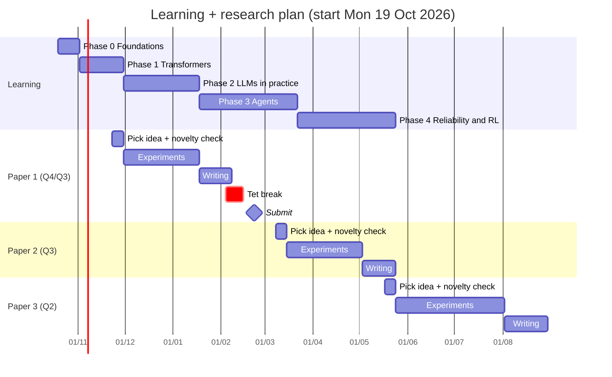

# Roadmap — 2 hours a day, learning and research in parallel

> [!summary] Tóm tắt (VI)
> Khoảng 6 tháng để học hết 5 chặng, song song là 3 bài báo: bài 1 và 2 nhắm Q4/Q3 hoặc hội nghị Scopus, bài 3 nhắm Q2.
> Có 3 chế độ trong ngày: chỉ học, vừa học vừa làm bài báo, và chạy nước rút viết bài. Lịch dưới đây giả định bắt đầu thứ Hai 19/10/2026.
> Trễ lịch là chuyện bình thường. Quy tắc duy nhất: không bỏ Anki quá 2 ngày liên tiếp.

## 1. The big picture

| Phase | Topic | Content length | Calendar time (2h/day) | Papers it feeds |
|---|---|---|---|---|
| 0 | Foundations: Python, math, PyTorch, reading papers | 10 lessons | 2 weeks | — |
| 1 | Transformers: tokens, embeddings, attention | 12 lessons | 4 weeks | Ideas 1A–1D |
| 2 | LLMs in practice: inference, prompting, evaluation, RAG, LoRA | 14 lessons | 7 weeks (shared with Paper 1) | Ideas 2A–2D |
| 3 | Agents: tool calling, ReAct, planning, memory, MCP | 14 lessons | 9 weeks (shared with Paper 1 writing and Paper 2) | Ideas 3A–3D |
| 4 | Reliability & RL: uncertainty, safety, reward, GRPO | 14 lessons | 9 weeks (shared with Paper 2 and 3) | Ideas 4A–4D |

Why this order: every phase only uses things taught earlier. You cannot understand RAG (Phase 2) without embeddings and cosine similarity (Phase 0–1). You cannot debug an agent (Phase 3) without knowing how the model picks the next token (Phase 1–2). You cannot train an agent with reinforcement learning (Phase 4) without gradients (Phase 0) and fine-tuning (Phase 2).

## 2. Timeline

The dates are a guide, not a contract. If you fall behind, **shift everything to the right** — never skip a phase.

## 3. Three daily modes

A Pomodoro here = 25 minutes of focus + 5 minutes off. Two hours = 4 Pomodoros.

| Mode | When | Pomodoro 1 | Pomodoro 2 | Pomodoro 3 | Pomodoro 4 | Extra |
|---|---|---|---|---|---|---|
| **Learning** | Phase 0, Phase 1 | Lesson part 1 | Lesson part 2 | Lesson part 3 | Exercises | Anki 10 min |
| **Dual** | While a paper is in "experiments" | Lesson part 1 | Lesson part 2 | Paper work | Paper work | Anki 10 min |
| **Writing sprint** | While a paper is in "writing" | Lesson (light) | Writing | Writing | Writing | Anki 10 min |

Put learning **first** in the session, when you are freshest. Paper work is more hands-on (running code, checking results) so it survives tiredness better.

Weekly rhythm: Monday–Saturday study. Sunday: Anki + a 30-minute weekly review (fill in [[03-progress-tracker]]), nothing else.

## 4. What each phase unlocks

```mermaid
flowchart TD
    subgraph P0["Phase 0 — Foundations"]
        A1[Python + NumPy] --> A2[Vectors · cosine similarity]
        A2 --> A3[Matrices]
        A3 --> A4[Probability · softmax · log loss]
        A4 --> A5[Derivatives · gradient descent]
        A5 --> A6[PyTorch · autograd]
    end
    subgraph P1["Phase 1 — Transformers"]
        B1[Neural network from scratch] --> B2[Tokenization]
        B2 --> B3[Embeddings]
        B3 --> B4[Attention]
        B4 --> B5[Transformer block]
        B5 --> B6[Train a tiny GPT on your laptop]
    end
    subgraph P2["Phase 2 — LLMs in practice"]
        C1[Decoding · sampling] --> C2[Prompting]
        C2 --> C3[Evaluation · LLM-as-judge]
        C3 --> C4[Retrieval · RAG]
        C4 --> C5[Fine-tuning · LoRA/QLoRA]
        C5 --> C6[Experiment design · statistics]
    end
    subgraph P3["Phase 3 — Agents"]
        D1[Function calling] --> D2[ReAct loop]
        D2 --> D3[Planning · reflection]
        D3 --> D4[Memory]
        D4 --> D5[Multi-agent · MCP]
        D5 --> D6[Agent benchmarks]
    end
    subgraph P4["Phase 4 — Reliability & RL"]
        E1[Uncertainty · calibration] --> E2[Hallucination detection]
        E2 --> E3[Prompt injection · safety]
        E3 --> E4[RL basics · reward]
        E4 --> E5[DPO · GRPO]
        E5 --> E6[Training a small agent with RL]
    end
    A6 --> B1
    B6 --> C1
    C6 --> D1
    D6 --> E1
```

## 5. Hardware plan

| Task | RTX 3050 6GB laptop | Google Colab (free T4 16GB) | Rented GPU (~0.3–0.8 USD/h, 24GB) |
|---|---|---|---|
| Phase 0–1 exercises, tiny GPT | ✅ | ✅ | not needed |
| Run 0.5B–3B models (4-bit) | ✅ | ✅ | not needed |
| Run 7B–8B models (4-bit) | ⚠️ slow, tight | ✅ | ✅ |
| QLoRA fine-tune 0.5B–1.5B | ✅ | ✅ | ✅ |
| QLoRA fine-tune 7B | ❌ | ⚠️ session limits | ✅ |
| GRPO on 0.5B–1.5B (Phase 4) | ❌ | ⚠️ | ✅ ~20–60 hours total |

Every paper idea lists its own compute estimate. All Q4/Q3 ideas fit the laptop + Colab. Q2/Q1 ideas may need 30–100 rented GPU hours (roughly 15–60 USD).

## 6. Choosing which paper to write

Ideas live in `paper-ideas/`. Rule of thumb:

- **Paper 1:** pick a Q4/Q3 idea from Phase 1 or Phase 2. Aim for a Scopus-indexed conference first (faster feedback).
- **Paper 2:** a Q4/Q3 idea from Phase 2 or 3, ideally reusing the data and code from Paper 1.
- **Paper 3:** a Q2/Q1 idea from Phase 3 or 4. By then you will have two papers' worth of tooling.

The ideas were designed as **one connected research line** (real-world Vietnamese input → robust retrieval → robust agents → agents that know when to ask). Each paper reuses the previous one's data and code, which is the cheapest way to publish quickly.
