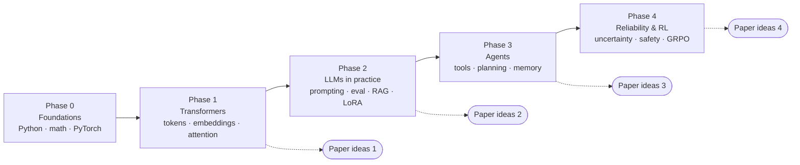

# LLM & Agentic AI — Learn, Build, Publish

> [!summary] Tóm tắt (VI)
> Khóa học tự học về LLM và Agentic AI, chia 5 chặng, chặng trước là nền cho chặng sau.
> Mỗi ngày học 2 tiếng, mỗi bài học tương ứng một buổi. Đáp án nằm riêng trong thư mục `solutions/`, thẻ Anki nằm trong `anki/`.
> Từ chặng 1 trở đi, mỗi chặng đi kèm ý tưởng bài báo ở hai mức: Q4/Q3 (bài đầu tay) và Q2/Q1 (khi đã vững).
> Bắt đầu bằng cách đọc [[01-study-method]] rồi mở [[06 - Courses/llm-agent-research-course/phase-0-foundations/README]].

## What this is

A self-study course that takes you from "I remember some Python" to running your own experiments on LLMs and agents and writing them up as papers. Learning and research run **in parallel**: each phase teaches the background you need for the paper ideas attached to it.

## Folder map

| Path | What is inside |
|---|---|
| [[00-roadmap]] | Timeline for 2 hours/day, when to switch from "learning mode" to "learning + paper mode" |
| [[01-study-method]] | How to study when you forget fast, get sleepy and lose focus — read this first |
| [[02-glossary]] | Master English–Vietnamese glossary, grows with every phase |
| [[03-progress-tracker]] | Tick lessons, log review dates, track paper progress |
| `phase-0-foundations/` | **Ready.** 10 lessons, solutions, Anki deck, figures |
| `phase-1-transformers/` … `phase-4-reliability-and-rl/` | Outlines now; full lessons will be written phase by phase |
| `paper-ideas/` | How to judge an idea, novelty checks, venues, and 16 concrete ideas |
| `templates/` | Obsidian templates for daily notes and paper reading notes |

## Every lesson has the same shape

1. **Tóm tắt (VI)** — 3–4 lines in Vietnamese so you know where you are going.
2. **Glossary** — English–Vietnamese table of the new terms.
3. **Warm-up recall** — 2–3 questions about earlier lessons, answered *before* reading.
4. **Content** split into ~25-minute parts (one Pomodoro each).
5. **Math, gently** — everyday example → picture → numbers by hand → formula → code.
6. **Exercises** — concept questions + coding tasks. Answers live in `solutions/`.
7. **Feynman box** — explain the lesson in 5 lines in your own words.
8. **Anki** — the lesson's cards are already in the phase deck.

## Setup in 10 minutes

1. Copy this whole folder into your Obsidian vault. Notes link to each other with Obsidian `[[links]]` and images use relative paths, so everything works as-is. Mermaid diagrams render natively in Obsidian.
2. Install Python 3.11+ and VS Code, or just use Google Colab (Lesson 0.1 walks through both).
3. Anki → File → Import → choose `phase-0-foundations/anki/phase-0.csv`. The file header sets the separator, deck and tags automatically (Anki 2.1.55 or newer).
4. Open [[01-study-method]], then start [[lesson-0.1-setup-and-python-basics|Lesson 0.1]].
