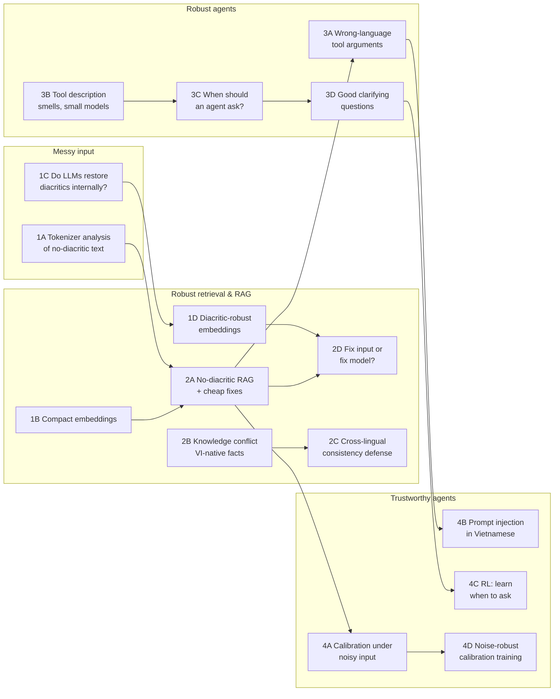
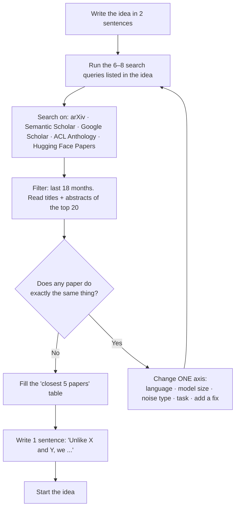

# Paper Ideas — how to choose, check and place them

> [!summary] Tóm tắt (VI)
> 16 ý tưởng, mỗi chặng 4 ý: 2 ý mức Q4/Q3 (làm được với laptop + Colab, phù hợp bài đầu tay) và 2 ý mức Q2/Q1 (cần vững kiến thức, có thể phải thuê GPU).
> Các ý tưởng nối với nhau thành một hướng nghiên cứu: văn bản tiếng Việt "đời thực" (gõ không dấu, viết tắt, phương ngữ) → tìm kiếm và RAG chịu được nhiễu → agent gọi công cụ đúng → agent biết khi nào nên hỏi lại. Bài sau dùng lại dữ liệu và code của bài trước.
> Đã kiểm tra sơ bộ độ mới vào 17/10/2026. Trước khi bắt tay làm, **bắt buộc** kiểm tra lại theo quy trình ở mục 3 vì mảng này ra bài mới mỗi tuần.

## 1. Why these ideas, and why this research line

You have no private data and a small GPU. That rules out "train a big model" and "we have exclusive industry data". What you *do* have:

- **You are a native Vietnamese speaker.** You can judge Vietnamese outputs, build small high-quality test sets, and spot failures that non-speakers miss.
- **Real Vietnamese text is messy.** People type without diacritics ("toi muon dat ve may bay"), use abbreviations and teen code ("ko", "dc", "j"), and regional words. Most benchmarks only test clean, standard text. A study in August 2026 showed [LLMs lose accuracy on Vietnamese dialect rewrites](https://arxiv.org/abs/2608.10414) but explicitly did not test diacritic removal or teen code, and did not test fixes such as normalization. That is an open door.
- **Small models are what people deploy.** A 1–8B model on a laptop or cheap server. Most papers test big API models. Testing small models is cheap for you *and* practically useful.

So all 16 ideas sit on one line, and each paper reuses the previous paper's code and data:

## 2. Idea index
Level: **Q4/Q3** = good first paper, laptop + Colab. **Q2/Q1** = needs solid skills, maybe 15–60 USD of rented GPU.
Novelty ★: how open the gap looked on 17/10/2026 (★★★ wide open, ★ crowded — needs a sharp angle).

| ID  | Title                                                                              | Level | Novelty | Main contribution type        | File              |
| --- | ---------------------------------------------------------------------------------- | ----- | ------- | ----------------------------- | ----------------- |
| 1A  | Why do LLMs fail on Vietnamese without diacritics? A tokenizer-level analysis      | Q4/Q3 | ★★★     | analysis                      | [[phase-1-ideas]] |
| 1B  | Compact embeddings for Vietnamese retrieval on consumer hardware                   | Q4    | ★       | empirical study               | [[phase-1-ideas]] |
| 1C  | Do LLMs silently restore diacritics? A mechanistic study                           | Q2/Q1 | ★★★     | interpretability + fix        | [[phase-1-ideas]] |
| 1D  | Diacritic-robust multilingual embeddings via noise-aware contrastive training      | Q2/Q1 | ★★      | method                        | [[phase-1-ideas]] |
| 2A  | Typing without diacritics: end-to-end robustness of Vietnamese RAG and cheap fixes | Q4/Q3 | ★★★     | benchmark + mitigation        | [[phase-2-ideas]] |
| 2B  | Which memory wins? Knowledge conflicts on Vietnam-native facts in RAG              | Q4/Q3 | ★★      | dataset + analysis            | [[phase-2-ideas]] |
| 2C  | Ask twice, trust once: cross-lingual consistency against knowledge conflicts       | Q2/Q1 | ★★      | method                        | [[phase-2-ideas]] |
| 2D  | Fix the input or fix the model? Cost-aware robustness for noisy low-resource text  | Q2/Q1 | ★★      | large empirical study + guide | [[phase-2-ideas]] |
| 3A  | Parameter values in the wrong form: Vietnamese tool calling with small models      | Q4/Q3 | ★★      | diagnosis + fix               | [[phase-3-ideas]] |
| 3B  | Do tool-description smells hurt small models more?                                 | Q4/Q3 | ★★      | replication + extension       | [[phase-3-ideas]] |
| 3C  | Spot the gap early: predicting when an agent should ask                            | Q2/Q1 | ★★      | method                        | [[phase-3-ideas]] |
| 3D  | What makes a good clarifying question for an agent?                                | Q2/Q1 | ★★      | metric + method               | [[phase-3-ideas]] |
| 4A  | Confidently wrong: calibration of small LLMs under noisy Vietnamese input          | Q4/Q3 | ★★★     | analysis                      | [[phase-4-ideas]] |
| 4B  | Injected in Vietnamese: indirect prompt injection against small-model agents       | Q4/Q3 | ★★      | attack study + defense eval   | [[phase-4-ideas]] |
| 4C  | Learning when to ask with reinforcement learning                                   | Q2/Q1 | ★★      | method (RL)                   | [[phase-4-ideas]] |
| 4D  | Noise-robust calibration: confidence that does not break on messy input            | Q2/Q1 | ★★      | method                        | [[phase-4-ideas]] |

## 3. Novelty check — do this before starting ANY idea

Takes one Pomodoro block (about 2 hours). Do it in the "Pick idea" week of the [[00-roadmap]].

Closest-papers table (copy into your notes):

| Paper | Year | What they did | What they did NOT do | How mine differs |
|---|---|---|---|---|
| | | | | |

Useful tools: [Semantic Scholar](https://www.semanticscholar.org), [Connected Papers](https://www.connectedpapers.com) (shows papers near a seed paper as a graph), [arXiv listing for cs.CL](https://arxiv.org/list/cs.CL/recent), [ACL Anthology](https://aclanthology.org). Set Google Scholar alerts for your 3 main keywords.

## 4. What reviewers reject (and how these ideas avoid it)

| Reviewer complaint | Typical cause | How to avoid |
|---|---|---|
| "Incremental / just applying X to Y" | Running an existing method on a new dataset, nothing else | Add a **why** (analysis of causes) or a **fix** (a mitigation that is tested) |
| "Just another language" | Repeating an English study in Vietnamese | Study something that only appears in Vietnamese-like languages (diacritics, tones), or test across several languages |
| "Weak baselines" | Comparing only to a naive prompt | Always include the strongest cheap baseline (e.g., a diacritic-restoration model, BM25, a bigger model) |
| "Not significant" | One run, small test set, no statistics | 3+ seeds, confidence intervals, test sets of 500+ items where possible (Phase 2 teaches this) |
| "Unclear contribution" | Contributions not stated | End the introduction with 3 numbered contributions |
| "Not reproducible" | No code/data | Release code + data on GitHub / Hugging Face |
| "LLM judge not validated" | Scoring with GPT without checking | Hand-label 100–200 items and report agreement with the judge |

## 5. Where to publish

**Check every venue yourself before submitting** — quartiles change every year and some journals get removed from Scopus. Use [SCImago (SJR)](https://www.scimagojr.com) for quartiles and Scopus Sources for indexing status.

**First papers (Q4/Q3 level), fastest feedback: Scopus-indexed conferences.** Vietnam-hosted ones are friendly to first-time authors and have Vietnamese-language tracks or interest:
- KSE (International Conference on Knowledge and Systems Engineering)
- RIVF (International Conference on Computing and Communication Technologies)
- SoICT (International Symposium on Information and Communication Technology)
- MAPR (Multimedia Analysis and Pattern Recognition), NICS (NAFOSTED Conference on Information and Computer Science)
- Regional: ACIIDS, PACLIC

Proceedings published in book series (Springer LNCS/LNAI/LNNS, IEEE Xplore) are Scopus-indexed but often have no journal quartile — check what your university or employer counts.

**Journals to check for Q3–Q2:** Vietnam Journal of Computer Science, Journal of Information and Telecommunication, ACM Transactions on Asian and Low-Resource Language Information Processing (TALLIP), Natural Language Processing Journal, Language Resources and Evaluation (good for dataset papers).

**Q1 / top tier:** Information Processing & Management, Knowledge-Based Systems, Expert Systems with Applications; and the ACL family (ACL, EMNLP, NAACL, and their *Findings*) — not quartile-ranked but highly respected; a Findings paper usually counts more than a Q2 journal for research careers.

**Avoid:** journals that email you to submit, promise review in 1–2 weeks, or charge high fees with guaranteed acceptance. Check the journal against Scopus' list of discontinued titles before submitting.

## 6. Reading list to frame the whole line

- [How Robust Are LLMs to Vietnamese Dialects?](https://arxiv.org/abs/2608.10414) — 2026; dialect rewrites lower accuracy for 10 models; mitigation left untested.
- [Which Works Best for Vietnamese? A Practical Study of Information Retrieval Methods across Domains](https://preview.aclanthology.org/new-sigs/2026.findings-eacl.110/) — EACL 2026 Findings; 10 datasets, 6 domains, released data and scripts. Your RAG experiments can start from this.
- [Don't Touch My Diacritics](https://arxiv.org/abs/2410.24140) — short position paper on how NLP pipelines mishandle diacritics. Good for motivation.
- [Lost in Execution: Multilingual Robustness of Tool Calling](https://preview.aclanthology.org/ingest-acl/2026.acl-long.2039/) — ACL 2026.
- [Ask Early, Ask Late, Ask Right: When Does Clarification Timing Matter for Long-Horizon Agents?](https://arxiv.org/abs/2605.07937) — 2026.
