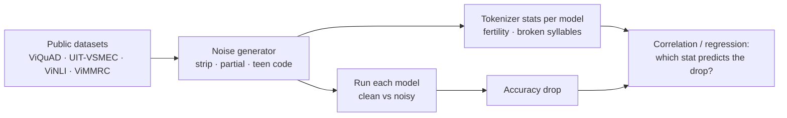
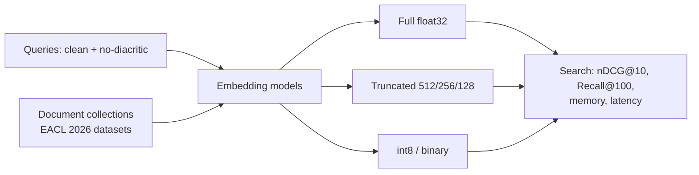
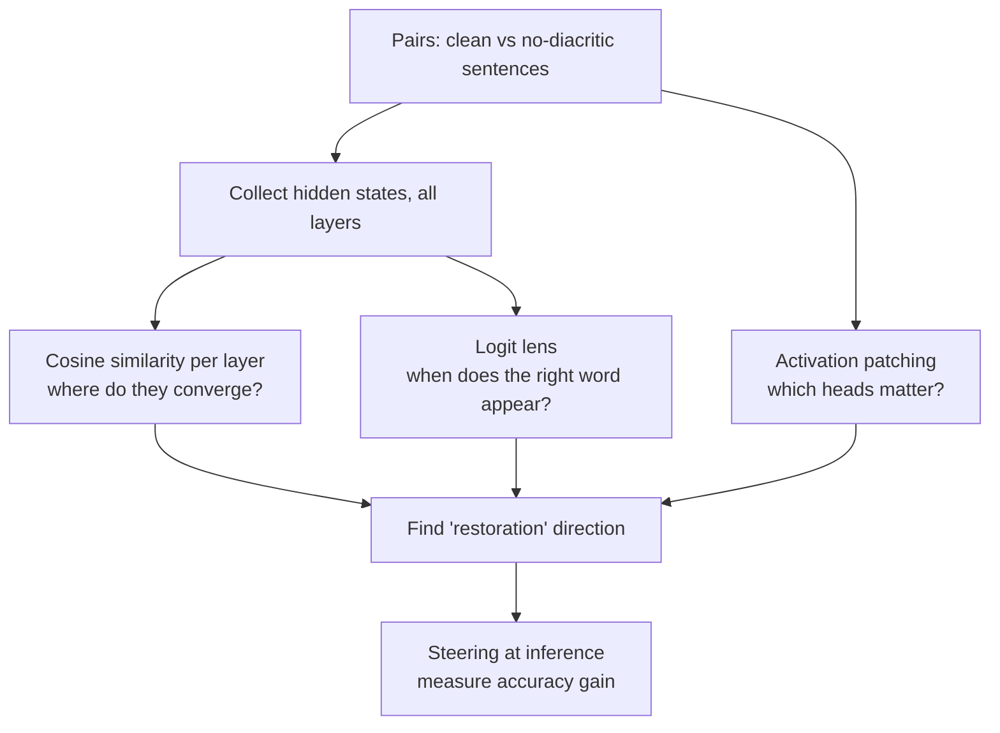
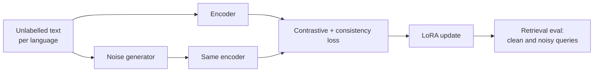

# Paper ideas from Phase 1 — Tokens, embeddings, attention

> [!summary] Tóm tắt (VI)
> Bốn ý tưởng xoay quanh một hiện tượng rất đời thường: người Việt gõ không dấu, gõ thiếu dấu, gõ tắt. Mô hình bị ảnh hưởng ra sao, vì sao, và sửa thế nào.
> 1A và 1B làm được ngay sau Phase 1 với laptop + Colab. 1C và 1D cần hiểu sâu hơn về bên trong mô hình và huấn luyện, nên để sau khi xong Phase 2.
> Đọc mục "Rủi ro bị chê" của từng ý trước khi chọn.

Prerequisites for all four: Phase 0, Phase 1 lessons on tokenization, embeddings and attention.

---

## 1A — Why do LLMs fail on Vietnamese without diacritics? A tokenizer-level analysis

**Level:** Q4/Q3 · **Novelty:** ★★★ · **Compute:** laptop + Colab · **Time:** ~8 weeks experiments + 3 weeks writing

### The problem in plain words
"Tôi muốn đặt vé máy bay" and "toi muon dat ve may bay" mean the same thing to a Vietnamese reader. To a model they are different token sequences. Accuracy drops, but nobody has measured *how much* across models and tasks, or *why*: is it because the tokenizer splits diacritic-free words into strange pieces, or because the model has simply seen less diacritic-free text?

### What already exists (checked 17/10/2026)
- [Dialect robustness study (2026)](https://arxiv.org/abs/2608.10414): 10 models, 4 Vietnamese tasks, six regional dialect groups. Accuracy drops on average. **It does not test diacritic removal or teen code**, and it uses only one reference model for perplexity analysis.
- [Don't Touch My Diacritics (2024)](https://arxiv.org/abs/2410.24140): argues that stripping diacritics raises token counts and hurts models, with small experiments in other languages. A position paper, not a systematic Vietnamese study.
- [PhonemicBERT / factorized syllable tokenizer (Sep 2026)](https://chatpaper.com/paper/346984): proposes a new tokenizer that splits Vietnamese syllables into onset, rime and tone. It is about building a new tokenizer, not explaining failures of existing LLMs.

**Gap:** no study links *tokenizer statistics* to *accuracy loss* across many open LLMs for diacritic-free and partially-diacritic Vietnamese.

### Contributions you can claim
1. A noise suite for Vietnamese: full diacritic removal, partial removal (25/50/75% of syllables), teen code, and mixed — applied automatically to 4 public datasets.
2. Measurements across 6–8 open LLMs: accuracy drop per noise type and per task.
3. An explanation: which tokenizer statistics (fertility change, broken-syllable rate, unknown-byte rate, perplexity ratio) best predict the accuracy drop — with correlation/regression analysis.
4. Released code and noisy datasets.

### Method

- Noise generation is a few lines of Python: decompose characters with `unicodedata.normalize("NFD", text)`, drop combining marks, map `đ → d`. Partial removal = apply to a random subset of syllables. Teen code = a rule table you write (ko, dc, j, mk…), checked by you.
- Fertility = average tokens per word. Compare clean vs noisy for each model's tokenizer.
- Prompting: fixed zero-shot prompts, greedy decoding, 4-bit quantized models.

### Data
All public: UIT-ViQuAD, UIT-VSMEC, ViNLI/ViANLI, ViMMRC. Some UIT datasets need a request form — check licences early. 400–1,000 test items per task is enough.

### Models
6–8 open models of 1–8B parameters across families (Qwen, Llama, Gemma, a Southeast-Asian model such as SeaLLM, a Vietnamese model such as Vistral). Use the newest small versions available when you start.

### Experiments and metrics
- Accuracy / F1 per task × model × noise level.
- Tokenizer stats per model × noise level.
- Spearman correlation and a simple linear regression: drop ~ fertility change + perplexity ratio + model size.
- Bootstrap confidence intervals for every drop (taught in Phase 2).

### What counts as a result
Either outcome is publishable: "tokenizer fragmentation explains most of the drop" (→ tokenizer design matters) or "it does not, model exposure matters more" (→ data matters). Make sure your write-up is framed around the question, not the hoped-for answer.

### Reviewer risks and how to handle them
| Risk | Mitigation |
|---|---|
| "Just a benchmark, no insight" | The explanation (contribution 3) is the core. Add a qualitative error analysis of 100 failures. |
| "Synthetic noise is unrealistic" | Add a small real set: 200 real diacritic-free queries collected from public forums or written by 5 friends. Show the trends match. |
| "Overlaps with the dialect paper" | Different noise type; cite it and position yours as complementary. |

### Novelty check queries
`Vietnamese diacritics LLM robustness` · `diacritic-free text large language model` · `tokenizer fertility noise robustness multilingual` · `Vietnamese teencode LLM` · `orthographic noise tokenization accuracy correlation` · `missing diacritics question answering`

### Venues
KSE, RIVF, SoICT, PACLIC; journals: Vietnam Journal of Computer Science, Journal of Information and Telecommunication.

---

## 1B — Compact embeddings for Vietnamese retrieval on consumer hardware

**Level:** Q4 · **Novelty:** ★ (crowded in general, thin for Vietnamese) · **Compute:** laptop · **Time:** ~5 weeks + 2 weeks writing

### The problem in plain words
Searching documents with embeddings needs memory: 1 million documents × 1,024 numbers × 4 bytes ≈ 4 GB. Two tricks shrink this: **truncation** (keep only the first 256 numbers, works for "Matryoshka" models trained for it) and **quantization** (store each number in 1 byte or even 1 bit). How much accuracy do Vietnamese searches lose?

### What already exists
Matryoshka and binary embeddings are well studied in English and multilingual benchmarks, and new work keeps appearing (e.g. [Matryoshka hash representations, 2026](https://arxiv.org/abs/2609.07276)). [The EACL 2026 Vietnamese IR study](https://preview.aclanthology.org/new-sigs/2026.findings-eacl.110/) compares many retrieval methods across 10 datasets but focuses on method families, not memory–accuracy trade-offs.

**Gap (narrow):** a practical, Vietnamese-specific trade-off map, plus a stress test with diacritic-free queries (where compression may hurt more).

### Contributions
1. Memory × latency × accuracy curves for 5–8 embedding models on the released Vietnamese IR datasets.
2. Finding whether compression and diacritic-free queries **interact** (does compression amplify the noise penalty?).
3. A recommendation table: "for X GB RAM, use model Y at dimension Z with int8".

### Method

### Data / models / compute
Datasets from the EACL 2026 paper (released). Multilingual embedding models (e5, bge-m3, gte family, Qwen embedding family) plus any Vietnamese-specific ones on Hugging Face. Everything runs on the laptop GPU.

### Reviewer risks
| Risk | Mitigation |
|---|---|
| "Known technique, just applied to Vietnamese" | This is the main risk. Make the interaction with diacritic-free queries the headline finding, not the compression itself. Aim at a conference, not Q2. |

### Novelty check queries
`Vietnamese embedding quantization retrieval` · `Matryoshka embedding low-resource language` · `binary embedding multilingual retrieval evaluation` · `embedding compression noisy queries`

### Venues
SoICT, KSE, NICS. Good as a fast second paper that reuses 1A's noise generator.

---

## 1C — Do LLMs silently restore diacritics? A mechanistic study

**Level:** Q2/Q1 · **Novelty:** ★★★ · **Compute:** laptop + Colab (models ≤ 2B) · **Time:** ~10–12 weeks + 4 weeks writing · **Do after Phase 2**

### The problem in plain words
When a model reads "toi muon an pho" and still answers correctly, *somewhere inside* it must figure out that "toi" means "tôi". Where? Early layers or late? Which attention heads do it? And if we can find that "restoring" signal, can we strengthen it to make the model more robust?

### What already exists
- Interpretability tools like the **logit lens** (read what the model "thinks" the next word is at every layer) and **activation patching** (swap internal values between two runs to see what matters) are standard in research on English.
- Diacritic restoration has been evaluated *as a task* (e.g. [LLMs for Romanian diacritic restoration, 2025](https://arxiv.org/abs/2511.13182)) but not studied *inside* the model.

**Gap:** no mechanistic account of how LLMs handle missing diacritics, in any language we could find.

### Contributions
1. Layer-wise evidence of where diacritic-free and diacritic representations converge (similarity of hidden states for "toi" vs "tôi" across layers).
2. Identification of components (heads/MLP layers) whose patching most affects correct interpretation.
3. A **steering fix**: add the "restored" direction at inference time and measure robustness gains on the 1A noise suite.
4. Cross-language check on 1–2 other diacritic languages (e.g. Romanian, Yoruba) to show generality.

### Method

### Data / models / compute
Pairs come free from 1A's noise generator. Models 0.5–2B (fit on 6GB with float16 or 8-bit). Libraries: TransformerLens or nnsight. Mostly forward passes — cheap.

### Reviewer risks
| Risk | Mitigation |
|---|---|
| "Findings on tiny models may not transfer" | Repeat key results on one 7–8B model on rented GPU (~10 hours). |
| "Correlational, not causal" | Activation patching *is* causal; make it central. |
| "Steering gains are small" | Report honestly; the mechanistic findings stand on their own. |

### Novelty check queries
`mechanistic interpretability diacritics` · `logit lens orthographic variation` · `how language models handle spelling noise internally` · `activation patching typo robustness` · `steering vector robustness noisy input`

### Venues
ACL/EMNLP Findings, BlackboxNLP workshop; journals: TALLIP, Natural Language Processing Journal. If results are strong, Q1 journals in NLP/AI.

---

## 1D — Diacritic-robust multilingual embeddings via noise-aware contrastive training

**Level:** Q2/Q1 · **Novelty:** ★★ · **Compute:** ~20–40 rented GPU hours · **Time:** ~10 weeks + 4 weeks writing · **Do after Phase 2**

### The problem in plain words
If a user searches "dich vu cong truc tuyen" (no diacritics), an embedding model should find documents about "dịch vụ công trực tuyến". Many do not. Can we fine-tune embedding models so that clean and noisy versions of the same text land in the same place — without hurting clean-text search — and does the same recipe work for other diacritic-heavy languages?

### What already exists
- Contrastive training of embedding models is standard; noise augmentation for typos exists for English.
- The factorized-syllable tokenizer of [PhonemicBERT (2026)](https://chatpaper.com/paper/346984) changes the tokenizer and retrains from scratch — expensive and not a drop-in for existing retrieval models.

**Gap:** a cheap fine-tuning recipe for *existing* multilingual embedding models, tested across several diacritic languages, with no clean-text regression.

### Contributions
1. A training recipe: contrastive loss on (clean, noisy) pairs + a consistency term, with LoRA so it runs on modest GPUs.
2. Evaluation on Vietnamese + 2–3 other languages with diacritics (e.g. Yoruba, Romanian, Czech).
3. Ablations: noise rate, which noise types, LoRA rank, amount of data.
4. Released models and code.

### Method

### Reviewer risks
| Risk | Mitigation |
|---|---|
| "Simple augmentation, low novelty" | Cross-language generality and careful ablations are the contribution; compare against a restoration-then-search pipeline (strong baseline). |
| "Hurts clean performance" | Report clean scores prominently; tune the consistency weight. |

### Novelty check queries
`diacritic robust embedding` · `noise-aware contrastive learning retrieval` · `typo robust dense retrieval multilingual` · `consistency regularization sentence embeddings noise`

### Venues
ACL/EMNLP Findings, Information Processing & Management, Knowledge-Based Systems, TALLIP.
