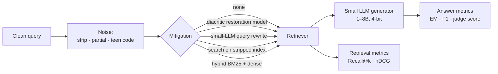
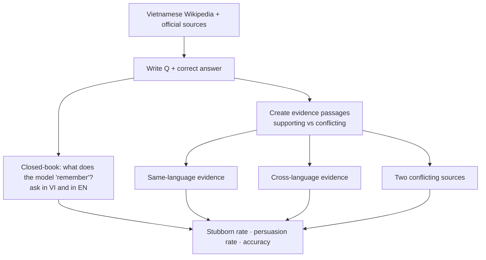
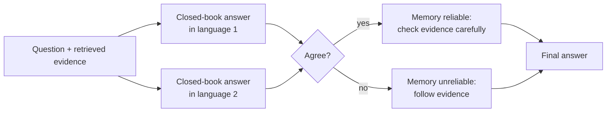
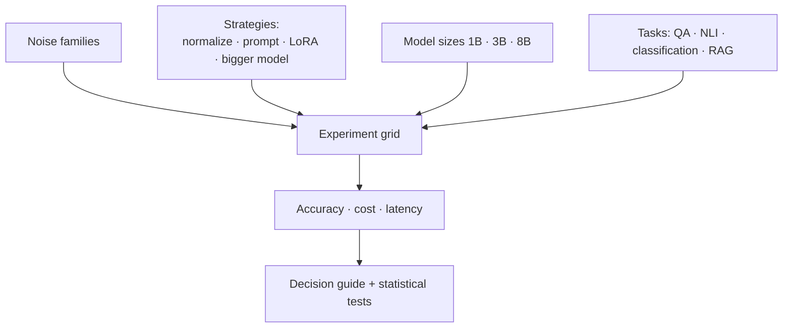

# Paper ideas from Phase 2 — LLMs in practice: evaluation, RAG, fine-tuning

> [!summary] Tóm tắt (VI)
> 2A là ứng viên tốt nhất cho bài báo đầu tay: lỗ hổng rõ, dữ liệu công khai, làm được trên laptop, có giá trị ứng dụng ngay.
> 2B xây bộ câu hỏi về kiến thức thuần Việt để xem khi tài liệu tìm được mâu thuẫn với "trí nhớ" của mô hình thì mô hình tin bên nào.
> 2C và 2D là bản nâng cấp lên Q2: một bên đề xuất phương pháp mới, một bên làm nghiên cứu thực nghiệm quy mô lớn có tính hướng dẫn.

Prerequisites: Phase 2 lessons on evaluation, RAG, LoRA, and experiment statistics.

---

## 2A — Typing without diacritics: end-to-end robustness of Vietnamese RAG and cheap fixes

**Level:** Q4/Q3 · **Novelty:** ★★★ · **Compute:** laptop + Colab · **Time:** ~7 weeks + 3 weeks writing · **Recommended first paper**

### The problem in plain words
A Vietnamese chatbot that answers from documents (RAG) has two steps: **find** relevant documents, then **write** an answer from them. Real users type "thu tuc cap lai can cuoc" instead of "thủ tục cấp lại căn cước". Which step breaks — finding or writing? And which cheap fix works best: restore diacritics first, rewrite the query with a small LLM, search on a diacritic-free copy of the index, or combine keyword + embedding search?

### What already exists (checked 17/10/2026)
- [Vietnamese IR study (EACL 2026 Findings)](https://preview.aclanthology.org/new-sigs/2026.findings-eacl.110/): compares retrieval methods on 10 datasets across 6 domains and releases data + scripts. Clean queries only, as far as the abstract shows.
- [Dialect robustness (2026)](https://arxiv.org/abs/2608.10414): shows LLM accuracy drops on dialect rewrites and **explicitly leaves normalization-based fixes untested**.
- [Quantization and RAG for small LLMs (2024)](https://arxiv.org/abs/2406.10251): studies quantized small models in RAG — English, clean queries.

**Gap:** an end-to-end study of noisy Vietnamese queries in RAG, separating retrieval failures from generation failures, plus a head-to-head comparison of cheap fixes with their cost.

### Contributions
1. A noisy-query version of 3–4 released Vietnamese QA/IR datasets (reusing the 1A noise generator if you did it).
2. A failure split: how much of the end-to-end drop comes from retrieval vs generation.
3. A comparison of 4–5 mitigations with accuracy **and** latency/cost.
4. Practical recommendations for builders of Vietnamese RAG systems.

### Method

Key trick for the failure split: also run the generator with the **gold** documents (oracle retrieval). If accuracy recovers with gold documents, retrieval is to blame; if not, generation is.

### Data
Datasets released with the EACL 2026 IR study + UIT-ViQuAD. Create ~200 real noisy queries by asking friends to retype questions the way they would on their phone — makes the study credible.

### Models and compute
Retrievers: BM25, 3–4 embedding models. Generators: 3–4 small instruct models, 4-bit. Diacritic restoration: an open Vietnamese restoration model from Hugging Face or a small seq2seq you fine-tune. All fits the laptop; Colab for 7–8B generators.

### Metrics and statistics
Recall@5/10, nDCG@10; exact match, F1; an LLM judge validated on 150 hand-labelled answers (report agreement). Bootstrap confidence intervals; paired tests between mitigations.

### Reviewer risks
| Risk | Mitigation |
|---|---|
| "Diacritic restoration solves it, so what?" | Then the paper says so with numbers and cost — still valuable. Also show where restoration fails (ambiguous syllables: "ban" → bàn/bán/bạn). |
| "Synthetic noise" | The 200 real queries. |
| "LLM judge reliability" | Hand-labelled agreement check. |

### Novelty check queries
`Vietnamese RAG noisy query` · `diacritic-free query retrieval augmented generation` · `query normalization RAG low-resource` · `robustness of RAG to query typos` · `Vietnamese question answering without diacritics`

### Venues
KSE, RIVF, SoICT; journals: Journal of Information and Telecommunication, Vietnam Journal of Computer Science. Strong execution → TALLIP.

---

## 2B — Which memory wins? Knowledge conflicts on Vietnam-native facts in RAG

**Level:** Q4/Q3 · **Novelty:** ★★ · **Compute:** laptop + small API budget (~10–20 USD) · **Time:** ~8 weeks + 3 weeks writing

### The problem in plain words
A model "remembers" facts from training. In RAG, it also reads documents. When they disagree, which does it trust? Earlier work found the answer can depend on the **language** of the question. For facts about Vietnam — local history, provinces after administrative mergers, Vietnamese public figures — the model's memory in English and in Vietnamese may differ. Does asking in Vietnamese make it more stubborn or more gullible?

### What already exists
- [CLEAR: knowledge conflict in multilingual models (2026)](https://arxiv.org/abs/2601.07041): 10 languages, **no Vietnamese**; datasets are **translations** of English benchmarks; authors list the lack of native cultural phenomena and of end-to-end retrieval pipelines as limitations.

**Gap:** native (not translated) Vietnam-specific facts, and an end-to-end retrieval setting.

### Contributions
1. A dataset of ~600–1,000 questions about Vietnam-native facts, written from Vietnamese sources, with correct and deliberately conflicting evidence passages, in Vietnamese and English.
2. Stubbornness and persuasion rates across query/evidence language combinations for 5–6 models.
3. An end-to-end variant where evidence comes from a real retriever, not pasted in.
4. Analysis of which fact types (dates, names, locations, numbers) are most conflict-prone.

### Method

### Reviewer risks
| Risk | Mitigation |
|---|---|
| "Extension of CLEAR to one more language" | The native-fact construction and the end-to-end retrieval setting are the new parts — make them prominent. Add the fact-type analysis. |
| "Dataset quality" | Two annotators for a 20% subset; report agreement. |
| "Facts change" | Record a date stamp; treat time-sensitive facts as a separate category (this is itself interesting). |

### Novelty check queries
`Vietnamese knowledge conflict LLM` · `cross-lingual knowledge conflict retrieval` · `culturally specific facts multilingual LLM memory` · `context vs parametric knowledge low-resource language`

### Venues
KSE, PACLIC, SoICT; Language Resources and Evaluation if the dataset is the main contribution.

---

## 2C — Ask twice, trust once: cross-lingual consistency as a defense against knowledge conflicts

**Level:** Q2/Q1 · **Novelty:** ★★ · **Compute:** ~20 rented GPU hours or ~30 USD API · **Time:** ~10 weeks + 4 weeks writing · **Builds on 2B**

### The problem in plain words
If the model gives **different** answers to the same question asked in Vietnamese and in English, its memory is probably unreliable — so it should trust the retrieved document more. If the answers **agree**, memory is probably reliable — so a conflicting document deserves suspicion. Can this simple "ask twice" signal decide when to trust context vs memory?

### What already exists
CLEAR (above) diagnoses the problem but proposes no fix. Cross-lingual consistency has been used as a hallucination signal in other work — check this carefully in the novelty search; the new part is using it to **arbitrate between context and memory** in RAG.

### Contributions
1. A training-free arbitration method based on cross-lingual agreement (plus a light-weight learned variant).
2. Evaluation on CLEAR's released data (if available) + the 2B dataset, several languages.
3. Comparison against strong baselines: always-trust-context, confidence-based arbitration, self-consistency in one language.
4. Cost analysis (extra queries) and an adaptive version that only asks twice when uncertain.

### Method

### Reviewer risks
| Risk | Mitigation |
|---|---|
| "Prior work used cross-lingual consistency" | Position as a new *use* (arbitration); compare directly against those methods as baselines. |
| "Only works when languages differ in memory" | Analyse when it helps vs not; that analysis is a contribution. |

### Novelty check queries
`cross-lingual consistency hallucination detection` · `cross-lingual self-consistency knowledge conflict` · `arbitrate parametric contextual knowledge` · `multilingual agreement trust retrieved context`

### Venues
ACL/EMNLP Findings, Information Processing & Management, Knowledge-Based Systems.

---

## 2D — Fix the input or fix the model? Cost-aware robustness strategies for noisy low-resource text

**Level:** Q2/Q1 · **Novelty:** ★★ · **Compute:** ~40–60 rented GPU hours · **Time:** ~12 weeks + 4 weeks writing · **Builds on 1A / 2A**

### The problem in plain words
A team building a Vietnamese product with messy user input has four choices: (a) clean the input first, (b) prompt the model to handle it, (c) fine-tune the model on noisy data with LoRA, (d) just use a bigger model. Each costs differently. Nobody has compared them systematically across noise types, tasks and model sizes. A careful, large study with a clear decision guide is valuable and citable.

### What already exists
Individual pieces exist (dialect benchmark without fixes, restoration models, noise-augmented fine-tuning in English). The [dialect paper](https://arxiv.org/abs/2608.10414) explicitly calls testing normalization and prompting mitigations an open step.

### Contributions
1. A full grid: 3 noise families (diacritics, teen code, dialect — using the dialect benchmark if released) × 4 strategies × 3 model sizes × 3–4 tasks.
2. Cost model: training cost, inference latency, extra calls.
3. A decision guide ("if your noise is X and budget Y, do Z") backed by statistics.
4. Released LoRA adapters.

### Method

### Reviewer risks
| Risk | Mitigation |
|---|---|
| "No new method" | Large rigorous empirical studies are accepted at top venues when the grid is complete and the guide is useful. Statistics and clean presentation are everything. |
| "Too big to finish" | Start with diacritics only; add teen code and dialect only if time allows — the paper is still coherent. |

### Novelty check queries
`normalization vs fine-tuning robustness noisy text LLM` · `robustness strategies comparison low-resource language` · `noise-augmented LoRA fine-tuning robustness` · `cost-aware robustness LLM deployment`

### Venues
TALLIP, Information Processing & Management, Natural Language Engineering, ACL/EMNLP Findings.
