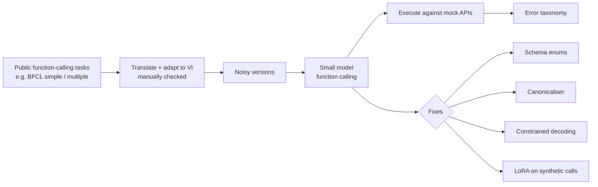
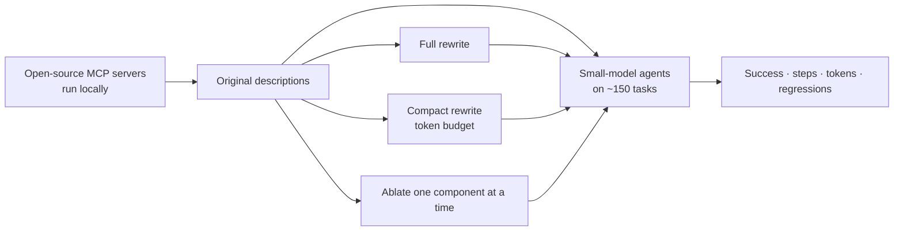
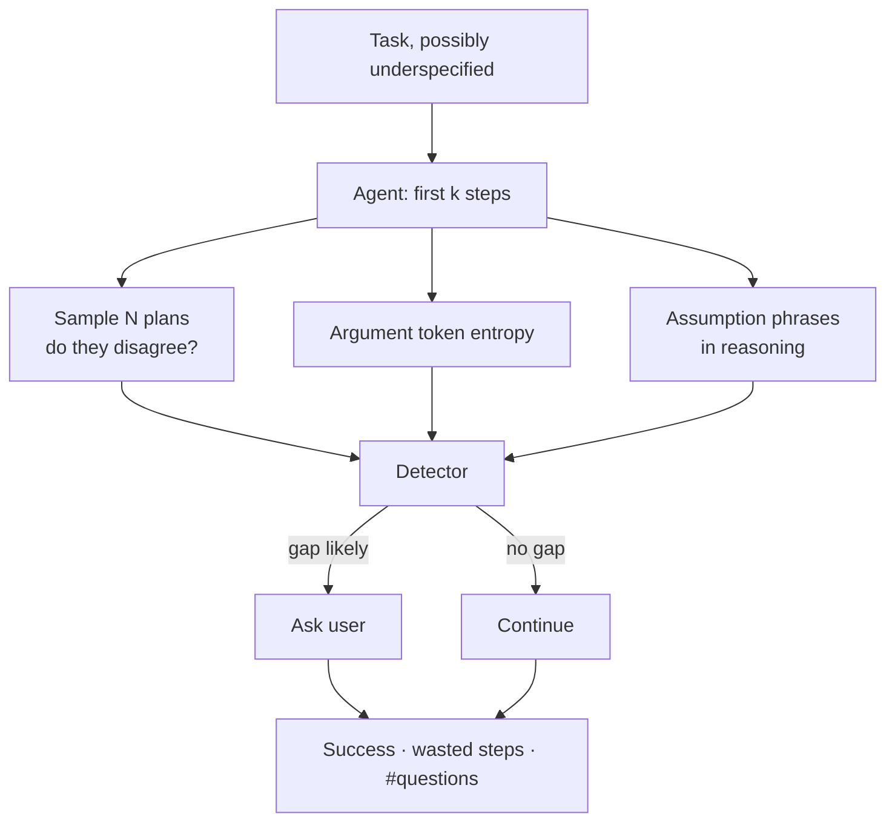
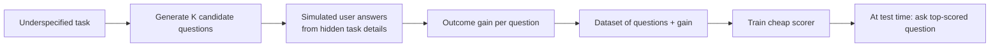

# Paper ideas from Phase 3 — Agents: tool calling, planning, clarification

> [!summary] Tóm tắt (VI)
> 3A: agent gọi công cụ bằng tiếng Việt hay điền sai dạng tham số (ví dụ "Hà Nội", "Ha Noi", "Hanoi"). Đo, chẩn đoán và sửa cho mô hình nhỏ.
> 3B: mô tả công cụ viết kém có làm mô hình nhỏ thất bại nặng hơn mô hình lớn không, và viết mô tả gọn mà vẫn hiệu quả.
> 3C và 3D (Q2): agent nên hỏi lại người dùng khi nào và hỏi gì. Đây là câu hỏi mở được nêu rõ trong một bài năm 2026.

Prerequisites: Phase 3 lessons on function calling, ReAct, MCP and agent evaluation.

---

## 3A — Parameter values in the wrong form: Vietnamese tool calling with small open models

**Level:** Q4/Q3 · **Novelty:** ★★ · **Compute:** laptop + Colab · **Time:** ~7 weeks + 3 weeks writing

### The problem in plain words
A user says "đặt phòng khách sạn ở Đà Nẵng tối mai". The agent picks the right tool `book_hotel` — but fills `city="Đà Nẵng"` when the API expects `"Da Nang"`, or writes the date as "tối mai" instead of `2026-10-18`. The call fails even though the model understood. With diacritic-free input ("da nang") or teen code, it gets worse.

### What already exists (checked 17/10/2026)
- [Lost in Execution (ACL 2026)](https://preview.aclanthology.org/ingest-acl/2026.acl-long.2039/): in Chinese, Hindi and Igbo, the main failure is **parameter values written in the user's language**; inference-time fixes help but **do not close the gap**. Vietnamese not covered.
- [MASSIVE-Agents (EMNLP 2025 Findings)](https://preview.aclanthology.org/dashboard/2025.findings-emnlp.1099): 52-language function-calling benchmark built from MASSIVE (whose language list includes Vietnamese — verify). It *measures* accuracy; it does not diagnose Vietnamese-specific failures or test fixes for small models.

**Gap:** Vietnamese is a Latin-script language where the mismatch is subtle (diacritics, word order of dates, units), and the input itself is often noisy. Diagnosis + fixes for small models are missing.

### Contributions
1. A Vietnamese tool-calling test set (~400 calls) adapted from public function-calling benchmarks, with clean, no-diacritic and teen-code versions.
2. A fine-grained error taxonomy (wrong tool, missing argument, wrong format, wrong-language value, hallucinated value).
3. Comparison of fixes: schema enums + descriptions, canonicalisation layer after the call, constrained decoding (JSON schema), and a small LoRA on synthetic calls.
4. Results for 5–6 small open models.

### Method

### Reviewer risks
| Risk | Mitigation |
|---|---|
| "Same finding as Lost in Execution" | Cite it; your contributions are the Vietnamese-specific taxonomy, noisy input, and *fixes that close the gap* for small models. |
| "Translated benchmark" | Add 100 tool-calls written natively by Vietnamese speakers for everyday tasks. |

### Novelty check queries
`Vietnamese function calling benchmark` · `multilingual tool calling parameter value` · `tool calling small language models non-English` · `canonicalization tool arguments LLM` · `constrained decoding function calling multilingual`

### Venues
KSE, SoICT, RIVF; Journal of Information and Telecommunication; TALLIP if fixes are strong.

---

## 3B — Do tool-description smells hurt small models more?

**Level:** Q4/Q3 · **Novelty:** ★★ · **Compute:** laptop + Colab · **Time:** ~6 weeks + 3 weeks writing

### The problem in plain words
Agents choose tools by reading their descriptions. A 2026 study found that almost all public MCP tool descriptions have quality problems ("smells"): unclear purpose, missing limitations, opaque parameters. Fixing them helps big models — but makes descriptions much longer. Small local models have short context and weaker reading. Do bad descriptions hurt them more? And can a **compact** fixed description get most of the benefit without the length?

### What already exists
- [MCP tool description smells (2026)](https://arxiv.org/abs/2602.14878): 856 tools from 103 servers; 97.1% have at least one smell; full rewriting raised median success by 5.85 points but increased agent steps by 67.46% and caused regressions in 16.67% of cases. Evaluated on **three large models** due to cost; the authors note this limitation.

**Gap:** small open models, and a length-aware rewriting method.

### Contributions
1. Replication of the smell rubric on a sample of servers + extension to 5–6 small open models (1.5–8B).
2. Per-smell sensitivity: which missing component hurts small models most.
3. A **compact rewrite** method constrained by a token budget, compared with full rewriting.
4. Analysis of the success–steps–tokens trade-off.

### Method

Use only servers that run locally without paid accounts (filesystem, SQLite, git, a mock weather server you write) so everything is free and reproducible.

### Reviewer risks
| Risk | Mitigation |
|---|---|
| "Replication" | Replication with a clear new axis (small models + compact rewriting) is accepted; say so openly in the introduction. |
| "Few tasks" | 150 tasks × 6 models × 4 description variants × 3 seeds is already ~10k runs — enough for paired statistics. |

### Novelty check queries
`MCP tool description quality small models` · `tool documentation small language model agents` · `tool description length agent performance` · `tool description rewriting token budget`

### Venues
SoICT, KSE; software-engineering-for-AI venues (e.g. workshops on LLM agents in SE); Journal of Systems and Software if extended.

---

## 3C — Spot the gap early: predicting when an agent should ask

**Level:** Q2/Q1 · **Novelty:** ★★ · **Compute:** ~30–50 rented GPU hours or API budget ~40 USD · **Time:** ~12 weeks + 4 weeks writing

### The problem in plain words
When a task is missing information ("book the usual hotel" — which one?), an agent should ask. Asking too late wastes work; asking too often annoys users. A 2026 study measured *how valuable* asking is at each moment, and found models ask at the wrong times — but explicitly left open **how an agent can detect the gap early**. That is this paper.

### What already exists
- [Ask Early, Ask Late, Ask Right (2026)](https://arxiv.org/abs/2605.07937): goal clarification is most valuable at the start; models' natural asking misses the best window. Open questions: early ambiguity detection; question quality.
- [Agent-based detection of incompleteness and ambiguity (2025)](https://arxiv.org/abs/2507.03726): uses LLM agents to detect and resolve ambiguity in user queries before acting — a prompting-based baseline you must compare against.

**Gap:** a detector that uses cheap signals from the agent's own early steps (not only the user query) to trigger a question at the right time.

### Contributions
1. Signals: disagreement among sampled plans, entropy of tool-argument tokens, "assumption" phrases in reasoning, retrieval failures.
2. A lightweight detector (logistic regression or small classifier) trained on these signals.
3. Evaluation on underspecified task variants (from the 2026 study's source benchmark if released, otherwise your own variants of public agent tasks): success, wasted steps, number of questions.
4. Comparison with prompting-based detection and "always ask first".

### Method

### Reviewer risks
| Risk | Mitigation |
|---|---|
| "Benchmark availability" | Build your own underspecified variants of 100–150 public agent tasks (remove one key detail each) — also a contribution. |
| "Signals are model-specific" | Test transfer: train detector on model A, test on model B. |

### Novelty check queries
`agent clarification question timing` · `detect underspecified instructions agent` · `uncertainty-triggered clarification tool use` · `when to ask LLM agents` · `ambiguity detection multi-step agent`

### Venues
ACL/EMNLP Findings, AAMAS workshops, Knowledge-Based Systems, Expert Systems with Applications.

---

## 3D — What makes a good clarifying question for an agent?

**Level:** Q2/Q1 · **Novelty:** ★★ · **Compute:** ~20–40 rented GPU hours · **Time:** ~10 weeks + 4 weeks writing · **Pairs with 3C**

### The problem in plain words
"Could you give me more details?" is a useless question. "Which of your two saved hotels — Mường Thanh or Novotel?" is a great one. The 2026 clarification study hypothesised that **question quality may matter more than how often the agent asks**, but did not test it. Can we measure question quality by how much it actually improves the outcome, and train agents to ask better ones?

### Contributions
1. A metric: **outcome gain** = task success with the answer to this question − success without it, estimated with a simulated user.
2. A dataset of agent questions with their outcome gains.
3. A method: generate several candidate questions, score them with a cheap predictor of outcome gain, ask the best one. Optionally fine-tune a small model on the best questions.
4. Human evaluation of 200 questions to validate the metric.

### Method

### Reviewer risks
| Risk | Mitigation |
|---|---|
| "Simulated users are unrealistic" | Human study on a subset; report agreement between simulated and human answers. |
| "Expected information gain already exists" | Cite question-asking work from dialogue/recommender systems; your angle is *outcome* gain in multi-step agents. |

### Novelty check queries
`clarifying question quality LLM agents` · `expected information gain clarification question LLM` · `learning to ask good questions tool use` · `user simulator clarification evaluation`

### Venues
ACL/EMNLP Findings, SIGDIAL, Information Processing & Management.
