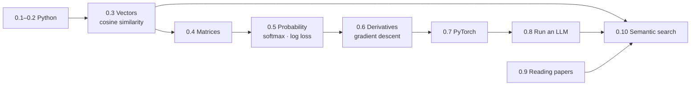

# Phase 0 — Foundations

> [!summary] Tóm tắt (VI)
> Hai tuần, 10 bài, mỗi bài một buổi 2 tiếng. Mục tiêu: đủ Python, đủ toán và đủ PyTorch để bước vào Transformer ở Phase 1 mà không bị "ngợp".
> Toán chỉ học đúng 4 thứ: vectơ, ma trận, xác suất/softmax, đạo hàm/hạ gradient. Mỗi thứ đều đi từ ví dụ đời thường, hình vẽ, tính tay rồi mới đến công thức.
> Bài cuối là một dự án nhỏ: công cụ tìm kiếm câu tiếng Việt theo nghĩa, và bạn sẽ tự thấy nó yếu đi thế nào khi gõ không dấu. Đó cũng chính là hạt giống cho bài báo đầu tiên.

## Lessons

| # | Lesson | Math? | Day |
|---|---|---|---|
| 0.1 | [[lesson-0.1-setup-and-python-basics]] | — | 1 |
| 0.2 | [[lesson-0.2-python-for-llm-work]] | — | 2 |
| 0.3 | [[lesson-0.3-vectors-and-similarity]] | ✏️ | 3 |
| 0.4 | [[lesson-0.4-matrices]] | ✏️ | 4 |
| — | Review day: Anki + redo exercises you got wrong | | 5 |
| 0.5 | [[lesson-0.5-probability-and-softmax]] | ✏️ | 6 |
| 0.6 | [[lesson-0.6-derivatives-and-gradient-descent]] | ✏️ | 7 |
| 0.7 | [[lesson-0.7-pytorch-basics]] | — | 8 |
| 0.8 | [[lesson-0.8-talking-to-an-llm]] | — | 9 |
| 0.9 | [[lesson-0.9-reading-research-papers]] | — | 10 |
| 0.10 | [[lesson-0.10-mini-project-semantic-search]] | — | 11–12 |

Days are study days (Monday–Saturday). Twelve study days = two weeks.

## How the pieces connect

Where each piece shows up later:

| Phase 0 concept | Where you will meet it again |
|---|---|
| Cosine similarity | Embeddings (P1), retrieval in RAG (P2), memory for agents (P3) |
| Matrix multiplication | Every layer of a neural network, attention (P1) |
| Softmax | Choosing the next token (P1), attention weights (P1), sampling (P2) |
| −log(p), cross-entropy | How every LLM is trained (P1), fine-tuning (P2) |
| Gradient descent | Training the tiny GPT (P1), LoRA (P2), RL (P4) |
| Reading papers | Every phase, every paper you write |

## Files

- `solutions/` — answers to warm-ups and exercises. Open only *after* trying.
- `anki/phase-0.csv` — import into Anki once (see the [course README](06%20-%20Courses/llm-agent-research-course/README.md)).
- `images/` — figures used in the lessons.

## Exit check

Before moving on, tick the Phase 0 exit check in [[03-progress-tracker]]. If any item is "no", redo that lesson's exercises first. Moving on with gaps makes Phase 1 painful.
