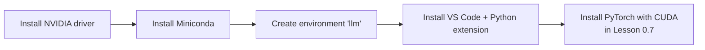
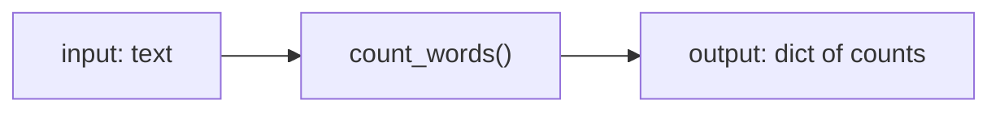

# Lesson 0.1 — Setup and Python basics

> [!summary] Tóm tắt (VI)
> Cài môi trường (Colab hoặc máy mình) và ôn lại Python từ gốc: biến, kiểu dữ liệu, danh sách, từ điển, câu lệnh điều kiện, vòng lặp, hàm.
> Không cần nhớ hết cú pháp. Mục tiêu là đọc hiểu được code và tự viết được hàm nhỏ.
> Mẹo: gõ lại mọi ví dụ, đừng copy-paste. Đổi một con số và đoán kết quả trước khi chạy.

**Time:** 2 hours (4 Pomodoros) · **You need:** a browser (Colab) or Python installed · **Math:** none

## Glossary

| English | Tiếng Việt | One-line meaning |
|---|---|---|
| notebook | sổ tay lập trình (notebook) | A page mixing code cells and text, e.g. Colab, Jupyter |
| cell | ô | One block of code you run at a time |
| variable | biến | A named box holding a value |
| type | kiểu dữ liệu | What kind of value: number, text, list… |
| string | chuỗi | Text, written in quotes |
| list | danh sách | An ordered collection: `[1, 2, 3]` |
| dictionary | từ điển | Key → value pairs: `{"name": "Hiếu"}` |
| index | chỉ số | Position in a list, **starting from 0** |
| loop | vòng lặp | Repeat something for each item |
| function | hàm | Named, reusable piece of code |
| return | trả về | The value a function gives back |
| virtual environment | môi trường ảo | A separate folder of packages for one project |

## Warm-up (5 min, no peeking)

This is the first lesson, so the warm-up is about you. Write answers on paper:

1. Why do you want to learn LLMs and agents? One sentence.
2. Which Python words do you still remember? List as many as you can in 2 minutes.
3. What is one thing you want to be able to build by the end of Phase 0?

Keep the paper. You will look at it again at the end of Phase 0.

---

## Part 1 — Get a place to run code (Pomodoro 1)

You have two options. **Use Option A for Phase 0.** Set up Option B calmly during this week; you need it by Lesson 0.7.

### Option A — Google Colab (zero install)

1. Go to `colab.research.google.com`, sign in with Google, click **New notebook**.
2. Type in the first cell and press `Shift + Enter`:

```python
print("Xin chào, LLM!")
```

3. Turn on the free GPU: **Runtime → Change runtime type → T4 GPU**. Check it:

```python
import sys
print(sys.version)
```

Colab sessions reset after some hours. Save notebooks in Google Drive (**File → Save a copy in Drive**).

### Option B — Your laptop (RTX 3050 6GB)



1. **Driver:** update the NVIDIA driver (GeForce Experience or nvidia.com). Open a terminal and run `nvidia-smi` — you should see "GeForce RTX 3050" and a CUDA version.
2. **Miniconda:** download from the official Anaconda site and install. It manages Python versions and environments.
3. **Create an environment** (a separate box of packages for this course):

```bash
conda create -n llm python=3.11 -y
conda activate llm
pip install numpy matplotlib jupyter
```

4. **VS Code:** install it, then the "Python" and "Jupyter" extensions. Open a folder, create `test.ipynb`, pick the `llm` kernel, run `print("ok")`.

> [!tip] Why an environment?
> Different projects need different package versions. An environment keeps them from breaking each other. Always `conda activate llm` before working.

---

## Part 2 — Values, variables, lists, dictionaries (Pomodoro 2)

### Variables and types

A variable is a labelled box. Python figures out the type from the value.

```python
name = "Hiếu"          # str (string = text)
age = 23               # int (whole number)
gpa = 8.58             # float (decimal number)
is_student = True      # bool (True / False)

print(type(name), type(age), type(gpa), type(is_student))
print(f"{name} is {age} years old, GPA {gpa}")   # f-string: put variables inside text
```

### Lists — ordered collections

```python
models = ["GPT", "Claude", "Qwen", "Llama"]
print(models[0])      # first item -> "GPT"   (counting starts at 0!)
print(models[-1])     # last item  -> "Llama"
print(models[1:3])    # slice: items 1 and 2 -> ["Claude", "Qwen"]
print(len(models))    # number of items -> 4

models.append("Gemma")     # add to the end
print(models)
```

Picture the indexes:

```
 index:    0        1        2       3
         ["GPT", "Claude", "Qwen", "Llama"]
 negative: -4      -3       -2      -1
```

Slicing `a[start:end]` takes `start` up to **but not including** `end`.

### Dictionaries — look things up by name

```python
model = {"name": "Qwen", "params_billion": 0.5, "open_source": True}
print(model["name"])              # -> Qwen
model["context_length"] = 32768   # add a new key
for key, value in model.items():
    print(key, "->", value)
```

LLM tools talk in dictionaries all the time: a chat message is `{"role": "user", "content": "Xin chào"}`. You will see this shape again in Lesson 0.8.

---

## Part 3 — Decisions, loops, functions (Pomodoro 3)

### if / elif / else

```python
score = 7.2
if score >= 8:
    grade = "Giỏi"
elif score >= 6.5:
    grade = "Khá"
else:
    grade = "Trung bình"
print(grade)
```

Indentation (4 spaces) is how Python knows which lines belong to the `if`. Wrong indentation = error.

### for loops

```python
sentence = "tôi đang học mô hình ngôn ngữ lớn"
words = sentence.split()          # split by spaces -> list of words
for i, w in enumerate(words):     # enumerate gives (index, item)
    print(i, w)
print("Number of words:", len(words))
```

### while loops — repeat until a condition is false

```python
steps = 0
value = 100
while value > 1:
    value = value / 2
    steps += 1          # same as steps = steps + 1
print(steps, value)
```

### Functions — name a piece of work

```python
def count_words(text, lowercase=True):
    """Return a dictionary: word -> how many times it appears."""
    if lowercase:
        text = text.lower()
    counts = {}
    for w in text.split():
        counts[w] = counts.get(w, 0) + 1   # get(w, 0): current count, or 0 if new
    return counts

print(count_words("Mèo ăn cá mèo ngủ"))
```

The text inside `"""..."""` is a docstring — it explains what the function does. Write one for every function; future-you will thank you.



> [!example] Research hook
> `count_words` is a baby tokenizer + counter. Real LLMs split text into **tokens**, not words. In Lesson 0.8 you will count tokens for the same sentence with and without Vietnamese diacritics — the difference is the seed of paper idea 1A.

---

## Exercises (Pomodoro 4)

### A. Predict, then run

Write your prediction **before** running each line.

1. `print([10, 20, 30, 40][1:])`
2. `print("ngôn ngữ".upper())`
3. `print(len({"a": 1, "b": 2, "a": 3}))`
4. What does this print?
   ```python
   total = 0
   for n in range(1, 5):
       total += n
   print(total)
   ```
5. What is wrong with this code?
   ```python
   def square(x):
   return x * x
   ```

### B. Write code

6. Write `average(numbers)` that returns the average of a list of numbers. Test with `[8, 7.5, 9]`.
7. Write `longest_word(text)` that returns the longest word in a sentence.
8. Given `prices = {"phở": 50000, "bún chả": 45000, "cơm tấm": 40000}`, print the dishes that cost less than 48,000.

### C. Challenge (optional)

9. Write `top_k_words(text, k)` that returns the `k` most common words, most common first. Hint: `sorted(counts.items(), key=lambda pair: pair[1], reverse=True)`.

➡️ Answers: [[solution-0.1]]

## Feynman box

Close this note. In 5 lines, explain to a friend who has never coded: what a list is, what a dictionary is, and what a function is. Use a real-life example for each.

## Key takeaways

- Indexes start at 0; slices exclude the end.
- Lists keep order; dictionaries find things by key.
- A function = input → work → output. Give it a docstring.

**Next:** [[lesson-0.2-python-for-llm-work]]
