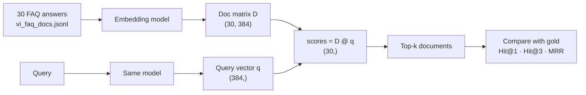

# Lesson 0.10 — Mini project: Vietnamese semantic search (and how it breaks)

> [!summary] Tóm tắt (VI)
> Dự án nhỏ trong 2 buổi: tự xây một công cụ tìm kiếm câu hỏi thường gặp tiếng Việt theo nghĩa, đo độ chính xác, rồi thử gõ không dấu để xem nó yếu đi bao nhiêu và thử vài cách sửa.
> Dùng lại mọi thứ đã học: chuỗi Unicode (0.2), cosin (0.3), nhân ma trận (0.4), chạy mô hình (0.8), đọc bài báo (0.9).
> Cuối dự án bạn viết một "bài báo mini" một trang. Đây là bản tập dượt thu nhỏ của ý tưởng 2A.

**Time:** 2 sessions (Day 1 + Day 2, 2 hours each) · **You need:** `pip install sentence-transformers`, the files in `data/` · **Math:** nothing new

## Glossary

| English | Tiếng Việt | One-line meaning |
|---|---|---|
| corpus | kho văn bản | The collection of documents you search in |
| query | truy vấn | What the user types |
| gold / ground truth | đáp án chuẩn | The correct document for a query |
| keyword search | tìm kiếm theo từ khóa | Match shared words |
| semantic search | tìm kiếm theo ngữ nghĩa | Match meaning via embeddings |
| Hit@k | tỉ lệ trúng trong top k | Share of queries whose gold document is in the top k results |
| MRR (mean reciprocal rank) | trung bình nghịch đảo thứ hạng | Average of 1 / (rank of the gold document) |
| hybrid search | tìm kiếm lai | Combine keyword and semantic scores |
| noise | nhiễu | Changes to the input that keep the meaning (e.g. no diacritics) |

## Warm-up (5 min, no peeking)

1. What are the three passes of reading a paper?
2. Write the formula for cosine similarity in words.
3. Why normalise Vietnamese text to NFC?

---

## The setup



Files (in `phase-0-foundations/data/`; on Colab, upload them with the folder icon on the left):
- `vi_faq_docs.jsonl` — 30 short answers about public services, health, transport, food, weather, tech, education and travel.
- `vi_faq_queries.jsonl` — 16 queries written in *different words* from the answers, each with its gold document ID.

---

## Day 1 — Build and measure

### Part 1 — Load data and a keyword baseline (Pomodoro 1)

Always build the simplest baseline first. If your fancy method cannot beat it, something is wrong.

```python
import json
import re
import unicodedata
import numpy as np

def load_jsonl(path):
    with open(path, encoding="utf-8") as f:
        return [json.loads(line) for line in f if line.strip()]

docs = load_jsonl("data/vi_faq_docs.jsonl")
queries = load_jsonl("data/vi_faq_queries.jsonl")
doc_texts = [unicodedata.normalize("NFC", d["text"]) for d in docs]
doc_ids = [d["id"] for d in docs]
print(len(docs), "docs,", len(queries), "queries")

def words(text):
    return set(re.findall(r"\w+", text.lower()))     # \w+ keeps letters with diacritics

def keyword_scores(query):
    q = words(query)
    return np.array([len(q & words(t)) / len(q | words(t)) for t in doc_texts])   # Jaccard overlap
```

**Jaccard overlap** = shared words ÷ all distinct words in both. 1 = identical word sets, 0 = nothing in common.

### Part 2 — Evaluation function (Pomodoro 2)

```python
def evaluate(score_fn, queries, transform=lambda s: s):
    hits1 = hits3 = rr = 0.0
    for item in queries:
        scores = score_fn(transform(item["query"]))
        ranking = [doc_ids[i] for i in np.argsort(-scores)]   # best first
        rank = ranking.index(item["gold"]) + 1                 # 1 = top
        hits1 += rank == 1
        hits3 += rank <= 3
        rr += 1 / rank
    n = len(queries)
    return {"Hit@1": round(hits1 / n, 3), "Hit@3": round(hits3 / n, 3), "MRR": round(rr / n, 3)}

print("keyword:", evaluate(keyword_scores, queries))
```

**MRR** in plain words: if the gold document is ranked 1st you get 1, 2nd → 1/2, 3rd → 1/3, … then average. It rewards putting the right answer near the top.

### Part 3 — Semantic search with embeddings (Pomodoro 3)

```python
from sentence_transformers import SentenceTransformer

model = SentenceTransformer("sentence-transformers/paraphrase-multilingual-MiniLM-L12-v2")
D = model.encode(doc_texts, normalize_embeddings=True)       # (30, 384), each row length 1
print(D.shape)

def semantic_scores(query):
    q = model.encode([query], normalize_embeddings=True)[0]   # (384,)
    return D @ q                                               # cosine, since all lengths are 1

print("semantic:", evaluate(semantic_scores, queries))

def show(query, k=3):
    s = semantic_scores(query)
    for i in np.argsort(-s)[:k]:
        print(f"  {s[i]:.3f}  {doc_texts[i]}")

show("bằng lái sắp hết hạn thì đổi ở đâu")
```

`normalize_embeddings=True` makes every vector length 1, so `D @ q` gives all 30 cosine similarities in one matrix multiplication (Lesson 0.4, exercise 6).

### Day 1 exercises (Pomodoro 4)

1. Record both results in a table. Which method wins on Hit@1? On MRR?
2. Find a query where keyword search fails but semantic search succeeds. Why does it happen? (Hint: compare the words in the query and in the gold answer.)
3. Find a query where semantic search ranks the gold answer below 1st. Look at what it ranked first. Is that mistake understandable?

---

## Day 2 — Break it, then fix it

### Part 1 — Add noise (Pomodoro 1)

```python
def strip_diacritics(text):
    text = text.replace("đ", "d").replace("Đ", "D")
    decomposed = unicodedata.normalize("NFD", text)
    return unicodedata.normalize("NFC", "".join(c for c in decomposed if unicodedata.category(c) != "Mn"))

results = {}
for name, fn in [("keyword", keyword_scores), ("semantic", semantic_scores)]:
    results[(name, "clean")] = evaluate(fn, queries)
    results[(name, "no diacritics")] = evaluate(fn, queries, transform=strip_diacritics)
for key, value in results.items():
    print(key, value)
```

Before running: **write down your prediction.** Which method will drop more? Then run and compare. Predicting first is how you train research intuition.

### Part 2 — Try three fixes (Pomodoro 2)

| Fix | Idea | Code hint |
|---|---|---|
| A. Strip both sides | Remove diacritics from documents too, so both sides match | build `doc_texts_stripped` and a second `D_stripped` |
| B. Hybrid | Add keyword and semantic scores | `0.5 * keyword + 0.5 * semantic` (on stripped docs for the keyword part) |
| C. Restore diacritics | Use a model to put diacritics back before searching | only as a stretch goal — find a Vietnamese diacritic-restoration model on the Hugging Face Hub |

Implement A and B, evaluate each on clean **and** noisy queries.

### Part 3 — Write a one-page mini paper (Pomodoro 3)

Create `my-notes/mini-paper-semantic-search.md` with this structure. Keep each section to 2–4 sentences — this is practice for the real thing.

```markdown
# Does Vietnamese semantic search survive missing diacritics? A tiny study

## 1. Question
## 2. Setup
(data: 30 docs, 16 queries; methods; metrics; model name and date)
## 3. Results
| Method | Clean Hit@1 | No-diacritics Hit@1 | Clean MRR | No-diacritics MRR |
## 4. What I observed
## 5. Limitations
(why these numbers cannot be trusted much yet — think about the size of the test set)
## 6. What I would do with more time
```

### Day 2 exercises (Pomodoro 4)

4. Which fix helped most on noisy queries? Did any fix **hurt** clean queries?
5. With only 16 queries, one query = 6.25 percentage points of Hit@1. What does this mean for comparing two methods that differ by 1 query? How many queries would you want for a real paper?
6. Partial noise: use `partial_strip` from Lesson 0.2 at ratios 0.25, 0.5, 0.75, 1.0. Plot Hit@1 vs ratio for keyword and semantic search.

### Challenge (optional)

7. Swap in a stronger multilingual embedding model from the Hugging Face Hub (e.g. from the e5, bge or gte families — read the model card; some need a prefix such as `"query: "` on queries). Does the gap between clean and noisy shrink?

➡️ Answers: [[solution-0.10]]

## Feynman box

In 5 lines: how your search engine works end to end, and what happened when diacritics disappeared.

## Key takeaways

- Always start with a simple baseline and a clear metric.
- Semantic search = embed everything, normalise, one matrix multiplication, sort.
- Small test sets give shaky numbers; real papers need hundreds of queries and confidence intervals (Phase 2).
- You have just done a miniature version of paper idea 2A. Look at [[phase-2-ideas]] again — it should feel much less abstract now.

**Phase 0 done?** Tick the exit check in [[03-progress-tracker]], then go to [[06 - Courses/llm-agent-research-course/phase-1-transformers/README]].
