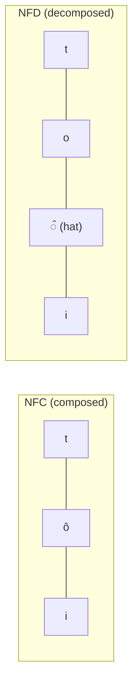

# Lesson 0.2 — Python for LLM work

> [!summary] Tóm tắt (VI)
> Ba kỹ năng Python dùng hằng ngày khi làm LLM: viết gọn bằng list comprehension, xử lý chuỗi tiếng Việt (Unicode, dấu), và đọc ghi file JSON/JSONL.
> Phần tiếng Việt rất quan trọng: cùng một chữ "tôi" có thể được lưu bằng hai cách khác nhau trong máy, và bỏ dấu chỉ cần vài dòng code. Đây là công cụ bạn sẽ dùng cho bài báo đầu tiên.
> Cuối bài có lớp (class) ở mức tối thiểu, đủ để đọc code của thư viện.

**Time:** 2 hours · **You need:** Colab or your `llm` environment · **Math:** none

## Glossary

| English                   | Tiếng Việt              | One-line meaning                                                 |
| ------------------------- | ----------------------- | ---------------------------------------------------------------- |
| list comprehension        | biểu thức tạo danh sách | Build a list in one line: `[x*2 for x in nums]`                  |
| Unicode                   | Unicode                 | The world standard that gives every character a number           |
| UTF-8                     | UTF-8                   | The usual way to store Unicode as bytes; 1–4 bytes per character |
| byte                      | byte                    | 8 bits; the smallest unit computers store                        |
| normalization (NFC / NFD) | chuẩn hóa (NFC / NFD)   | NFC = letter and mark combined; NFD = letter + separate mark     |
| combining mark            | dấu kết hợp             | A mark (like ´ or ̂) stored as its own character after a letter  |
| JSON / JSONL              | JSON / JSONL            | Text format for data / one JSON object per line                  |
| exception / traceback     | ngoại lệ / vết lỗi      | An error / the report showing where it happened                  |
| class / method            | lớp / phương thức       | A blueprint for objects / a function that belongs to a class     |

## Warm-up (5 min, no peeking)

1. What does `["a", "b", "c", "d"][1:3]` give?
2. How do you add a new key `"lang"` with value `"vi"` to a dictionary `d`?
3. What does `return` do inside a function?

---

## Part 1 — Write less, do more (Pomodoro 1)

### List comprehensions

The loop pattern "make an empty list, loop, append" is so common that Python has a shortcut:

```python
nums = [1, 2, 3, 4, 5]

squares = []
for n in nums:
    squares.append(n * n)

squares_short = [n * n for n in nums]                 # same result
evens = [n for n in nums if n % 2 == 0]               # with a filter
print(squares, squares_short, evens)
```

Read it right-to-left like a sentence: "for each `n` in `nums`, (if `n` is even), keep `n * n`".

Dictionary version:

```python
words = ["mèo", "chó", "cá"]
lengths = {w: len(w) for w in words}
print(lengths)     # {'mèo': 3, 'chó': 3, 'cá': 2}
```

### Three built-ins you will use daily

```python
questions = ["Q1", "Q2", "Q3"]
answers = ["A1", "A2", "A3"]

for q, a in zip(questions, answers):      # walk two lists side by side
    print(q, "->", a)

scores = {"qwen": 0.71, "llama": 0.65, "gemma": 0.69}
ranking = sorted(scores, key=scores.get, reverse=True)  # keys sorted by value
print(ranking)

for i, name in enumerate(ranking, start=1):              # numbered list
    print(i, name)
```

### Reading an error message

Errors are not failures, they are directions. Read the **last line** first, then look up for the line number in *your* file.

```python
data = {"model": "qwen"}
try:
    print(data["size"])
except KeyError as e:
    print("Missing key:", e)
```

`try/except` catches the error so the program keeps running. Without it, Python stops and prints a traceback like this:

```
Traceback (most recent call last):
  File "test.py", line 2, in <module>     <- where (your line)
    print(data["size"])
KeyError: 'size'                          <- what (read this first)
```

Common ones: `KeyError` (no such key), `IndexError` (list too short), `TypeError` (wrong type, e.g. `"a" + 1`), `NameError` (typo in a variable name), `IndentationError`.

---

## Part 2 — Vietnamese text in the computer (Pomodoro 2)

This part matters for your research. Read slowly.

### Every character is a number

```python
for ch in "Hà":
    print(ch, ord(ch))      # ord = the Unicode number of a character
```

### The same word can be stored in two ways

The letter "ô" can be stored as **one** character (`ô`) or as **two**: the plain letter `o` followed by a separate "hat" mark `̂`. They look identical on screen.



```python
import unicodedata

a = unicodedata.normalize("NFC", "tôi")
b = unicodedata.normalize("NFD", "tôi")
print(a, b)                  # look the same
print(a == b)                # False!
print(len(a), len(b))        # 3 vs 4 characters
print(len(a.encode("utf-8")), len(b.encode("utf-8")))   # bytes: 4 vs 5
```

Why you care: text scraped from different websites can mix NFC and NFD. Then "tôi" ≠ "tôi" in your code, search fails, and token counts change. **Rule: always normalize to NFC when you load Vietnamese text.**

### Removing diacritics in 4 lines

NFD splits each letter from its marks, so removing marks is easy: decompose, drop every "combining mark" (Unicode category `Mn`), done. The only special case is `đ`, which is a separate letter, not d + mark.

```python
import unicodedata

def strip_diacritics(text):
    """'Tôi đang học' -> 'Toi dang hoc'"""
    text = text.replace("đ", "d").replace("Đ", "D")
    decomposed = unicodedata.normalize("NFD", text)
    kept = [ch for ch in decomposed if unicodedata.category(ch) != "Mn"]
    return unicodedata.normalize("NFC", "".join(kept))

print(strip_diacritics("Tôi đang học mô hình ngôn ngữ lớn"))
```

> [!example] Research hook
> You just wrote the core of the "noise generator" used in paper ideas 1A, 2A and 4A. In Lesson 0.10 you will use it to test a search engine with diacritic-free queries.

### Bytes: what tokenizers really see

Modern tokenizers start from **bytes**, not letters. Vietnamese letters with marks take 2–3 bytes each, so the same sentence is "longer" for the tokenizer than an English one:

```python
for s in ["toi dang hoc", "tôi đang học", "I am studying"]:
    print(f"{s!r:20} chars={len(s):3} bytes={len(s.encode('utf-8'))}")
```

---

## Part 3 — Files, JSON, and a tiny class (Pomodoro 3)

### JSON — how LLM data is stored

```python
import json

sample = {"question": "Thủ đô của Việt Nam là gì?", "answer": "Hà Nội", "lang": "vi"}

with open("sample.json", "w", encoding="utf-8") as f:     # always encoding="utf-8"
    json.dump(sample, f, ensure_ascii=False, indent=2)     # ensure_ascii=False keeps Vietnamese readable

with open("sample.json", encoding="utf-8") as f:
    loaded = json.load(f)
print(loaded["answer"])
```

### JSONL — one record per line

Datasets for LLMs are usually JSONL: each line is its own JSON object. Easy to stream, easy to append.

```python
rows = [
    {"id": 1, "text": "Mèo ăn cá"},
    {"id": 2, "text": "Chó chạy nhanh"},
]
with open("data.jsonl", "w", encoding="utf-8") as f:
    for r in rows:
        f.write(json.dumps(r, ensure_ascii=False) + "\n")

with open("data.jsonl", encoding="utf-8") as f:
    data = [json.loads(line) for line in f]
print(data)
```

### A tiny class

You will not write many classes, but libraries are full of them (`model.generate(...)`, `tokenizer.encode(...)`). A class bundles data and the functions that work on it.

```python
class Conversation:
    """A chat history in the format LLM APIs expect."""

    def __init__(self, system_prompt):          # runs when you create the object
        self.messages = [{"role": "system", "content": system_prompt}]

    def add(self, role, content):               # a method
        self.messages.append({"role": role, "content": content})

    def __len__(self):
        return len(self.messages)

chat = Conversation("Bạn là trợ lý hữu ích.")
chat.add("user", "Xin chào!")
print(len(chat), chat.messages)
```

`self` means "this particular object". `chat.add(...)` is the same as `Conversation.add(chat, ...)`.

### Installing packages

```bash
pip install requests tqdm
```

In Colab, put `!` in front: `!pip install tqdm`.

---

## Exercises (Pomodoro 4)

### A. Check your understanding

1. Rewrite with a list comprehension:
   ```python
   out = []
   for w in ["Mèo", "CHÓ", "Cá"]:
       out.append(w.lower())
   ```
2. Two strings look identical but `a == b` is `False`. Name the most likely cause and the fix.
3. Why does `strip_diacritics` handle `đ` separately?
4. Why use `ensure_ascii=False` when saving Vietnamese JSON?

### B. Write code

5. Write `partial_strip(text, ratio, seed=0)` that removes diacritics from a random `ratio` (0–1) of the **words** in a sentence. Use `random.Random(seed)` so results are repeatable. (This is "partial removal" from idea 1A.)
6. Write `load_jsonl(path)` and `save_jsonl(rows, path)`. Save 3 question–answer pairs, load them back, and print only the questions.
7. Add a method `to_text()` to `Conversation` that returns the whole chat as one string, one line per message, like `user: Xin chào!`.

### C. Challenge (optional)

8. Some Vietnamese words become the **same** word after stripping: "bán", "bàn", "bạn" → "ban". Write code that takes a list of Vietnamese words and groups them by their stripped form. Which stripped forms have the most different originals? (This ambiguity is why diacritic restoration is hard.)

➡️ Answers: [[solution-0.2]]

## Feynman box

In 5 lines: why can two identical-looking Vietnamese strings be different to Python, and how do you remove diacritics?

## Key takeaways

- Comprehensions replace the "empty list + loop + append" pattern.
- Normalize Vietnamese text to NFC when loading it. NFD makes removing diacritics trivial.
- LLM data lives in JSON/JSONL. Always open files with `encoding="utf-8"`.

**Next:** [[lesson-0.3-vectors-and-similarity]]
