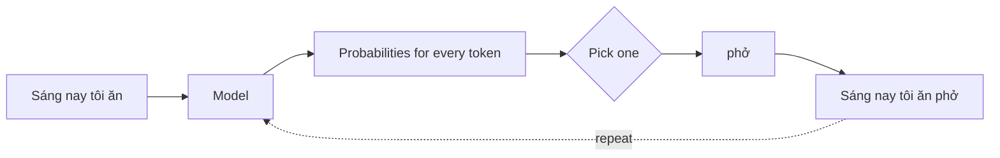

# Lesson 0.5 — Probability, softmax, and the loss that trains every LLM

> [!summary] Tóm tắt (VI)
> Một LLM thực chất làm đúng một việc: đoán xác suất cho chữ tiếp theo. Bài này giải thích ba thứ đứng sau việc đó.
> Softmax biến điểm số thô thành xác suất (cộng lại bằng 1). Nhiệt độ (temperature) là núm vặn làm mô hình "chắc ăn" hay "phiêu" hơn.
> Hàm mất mát −log(p) phạt rất nặng khi mô hình tự tin mà sai. Đây chính là thứ được tối thiểu hóa khi huấn luyện mọi LLM.

**Time:** 2 hours · **You need:** NumPy, a calculator · **Math:** ✏️ gentle (exp and log explained from zero)

## Glossary

| English | Tiếng Việt | One-line meaning |
|---|---|---|
| probability | xác suất | A number from 0 (never) to 1 (certain) |
| probability distribution | phân phối xác suất | Probabilities for all outcomes; they add up to 1 |
| sample / sampling | lấy mẫu | Pick an outcome at random according to its probability |
| greedy decoding | giải mã tham lam | Always pick the most likely token |
| logits | logit (điểm thô) | Raw scores before softmax; can be any number |
| exponential (exp) | hàm mũ | e raised to a power; always positive |
| softmax | softmax | exp each score, divide by the total |
| temperature | nhiệt độ | Divide logits by T before softmax: low T = confident, high T = random |
| logarithm (log) | lôgarit | The power you need: log₁₀(1000) = 3 |
| cross-entropy loss | mất mát entropy chéo | −log(probability given to the correct answer) |
| perplexity | độ bối rối | exp(average loss) ≈ "how many options the model is torn between" |

## Warm-up (5 min, no peeking)

1. Shape of `(8, 5) @ (5, 3)`?
2. What does each cell of a matrix product represent?
3. In `y = W x + b`, what is `b`?

---

## Part 1 — An LLM is a next-word probability machine (Pomodoro 1)

### Probability in one minute

The forecast says 70% rain. That is a probability of 0.7. The other outcome, no rain, must be 0.3 — because something has to happen, all probabilities together add up to 1. A list of outcomes with probabilities adding to 1 is a **distribution**.

### What an LLM outputs

Give a model the text "Sáng nay tôi ăn". It does **not** output a word. It outputs a probability for **every** token in its vocabulary (often 100,000+ tokens):

| Next token | Probability |
|---|---|
| phở | 0.55 |
| bún | 0.25 |
| cơm | 0.14 |
| pizza | 0.04 |
| sushi | 0.02 |
| … (100,000 others) | ≈ 0 |

Then a **decoding** rule picks one:
- **Greedy:** always the highest → "phở". Predictable, sometimes repetitive.
- **Sampling:** roll a weighted die → "phở" 55% of the time, "bún" 25%… More varied.

Append the chosen token, run the model again, repeat. That loop is how all text from ChatGPT, Claude, Qwen… is produced.



```python
import numpy as np

tokens = ["phở", "bún", "cơm", "pizza", "sushi"]
probs = np.array([0.55, 0.25, 0.14, 0.04, 0.02])
print(probs.sum())                                 # 1.0

rng = np.random.default_rng(42)
print("greedy:", tokens[np.argmax(probs)])
print("sampled:", [str(rng.choice(tokens, p=probs)) for _ in range(10)])
```

---

## Part 2 — Softmax: turning scores into probabilities (Pomodoro 2)

The last layer of the model gives raw scores called **logits**, e.g. `[3.0, 2.2, 1.6, 0.4, -0.5]`. They can be negative and do not add to 1. We need a recipe that:
1. makes every number positive,
2. keeps the order (bigger score → bigger probability),
3. makes them add to 1.

"Just divide by the total" fails: negative scores would give negative probabilities. The fix is the **exponential**.

### Meet exp(x) — in plain words

`e` is a fixed number, about 2.718 (like π is about 3.14). `exp(x)` means e multiplied by itself x times:

| x | −2 | −1 | 0 | 1 | 2 | 3 |
|---|---|---|---|---|---|---|
| exp(x) | 0.135 | 0.368 | 1 | 2.718 | 7.389 | 20.09 |

Two facts are all you need: **exp is always positive**, and **it grows fast**, so bigger scores win by a lot.

### Softmax by hand

Scores `[2, 1, 0]`:

```
Step 1 — exp each:   exp(2) = 7.389   exp(1) = 2.718   exp(0) = 1.000
Step 2 — add them:   7.389 + 2.718 + 1.000 = 11.107
Step 3 — divide:     7.389/11.107 = 0.665
                     2.718/11.107 = 0.245
                     1.000/11.107 = 0.090        (sum = 1.000 ✓)
```

As a formula (same three steps):

$$
\text{softmax}(z)_i = \frac{e^{z_i}}{\sum_j e^{z_j}}
$$

The Σ ("sigma") just means "add up over all j".

### Temperature: the confidence knob

Divide the scores by a number T **before** softmax:

```
T = 0.5 -> scores [4, 2, 0] -> probs [0.867, 0.117, 0.016]   (sharper, more confident)
T = 1   -> scores [2, 1, 0] -> probs [0.665, 0.245, 0.090]
T = 2   -> scores [1, 0.5, 0] -> probs [0.506, 0.307, 0.186] (flatter, more random)
```


When you set `temperature=0.2` in an API, you get near-greedy, factual-style output; `temperature=1.2` gives more creative, riskier output.

```python
import numpy as np

def softmax(z, temperature=1.0):
    z = np.asarray(z, dtype=float) / temperature
    z = z - z.max()                 # stability trick: does not change the result
    e = np.exp(z)
    return e / e.sum()

print(softmax([2, 1, 0]))           # [0.665 0.245 0.090]
print(softmax([2, 1, 0], 0.5))
print(softmax([2, 1, 0], 2.0))
print(softmax([1000, 999, 998]))    # works thanks to the stability trick
```

Why subtract the max? `exp(1000)` is too big for the computer (overflow). Subtracting the same number from every score does not change softmax (the factor cancels in the division) but keeps numbers small.

---

## Part 3 — Log, surprise, and the training loss (Pomodoro 3)

### Meet log(x) — in plain words

The log answers: "**what power do I need?**"

```
log₁₀(1000) = 3     because 10³ = 1000
log₁₀(0.01) = −2    because 10⁻² = 0.01
```

In ML we use the natural log, `ln` or `log`, which uses e instead of 10. Same idea. Two facts you need:

1. **log of a number between 0 and 1 is negative.** Probabilities are between 0 and 1, so their logs are ≤ 0.
2. **log turns multiplication into addition:** log(a × b) = log(a) + log(b).

Fact 2 matters because the probability of a whole sentence is the product of the probabilities of each token: 0.5 × 0.3 × 0.1 × … — after 100 tokens that is a tiny number the computer rounds to 0. Adding logs avoids that.

### The loss: −log(p) = "surprise"

During training, we know the correct next token. We look at the probability `p` the model gave to it:

```
loss = −log(p)
```


| p given to the correct token | loss | Interpretation |
|---|---|---|
| 0.9 | 0.11 | confident and right → tiny loss |
| 0.5 | 0.69 | unsure → medium loss |
| 0.1 | 2.30 | thought it unlikely → big loss |
| 0.001 | 6.91 | confidently wrong → huge loss |

This is **cross-entropy loss**. Training an LLM means: adjust the weights so that, averaged over trillions of tokens, this number goes down. Nothing more mysterious than that.

### Perplexity

Average the loss over a text, then undo the log with exp:

```
correct-token probs: 0.5, 0.25, 0.125
losses:              0.693, 1.386, 2.079   -> average 1.386
perplexity = exp(1.386) = 4.0
```

Perplexity 4 ≈ "on average the model was as unsure as if choosing between 4 equally likely words". Lower is better. You will use perplexity in paper idea 1A to measure how "strange" diacritic-free text looks to a model.

```python
import numpy as np

p_correct = np.array([0.5, 0.25, 0.125])
losses = -np.log(p_correct)
print(losses, losses.mean(), np.exp(losses.mean()))   # perplexity 4.0
```

> [!example] Research hook
> If a model gives "toi muon an pho" a much higher perplexity than "tôi muốn ăn phở", the text looks unfamiliar to it — and accuracy usually suffers. Comparing perplexity on clean vs noisy text is one of the measurements in ideas 1A and 4A.

---

## Exercises (Pomodoro 4)

### A. By hand (calculator allowed)

1. Probabilities for 4 tokens are `[0.5, 0.2, 0.2, x]`. What is x?
2. Compute softmax of `[1, 1, 1]`. Explain the answer without computing.
3. Compute softmax of `[0, ln 3]` (hint: exp(ln 3) = 3).
4. The model gives the correct token probability 0.25. What is the loss? (ln 2 ≈ 0.693)
5. Model A has perplexity 12 on a test set, model B has 30. Which is better at predicting that text?
6. Does temperature change which token greedy decoding picks? Why?

### B. Code

7. Using `softmax`, plot (or print) the probability of the top token for temperatures `[0.1, 0.5, 1, 2, 5]` with logits `[3.0, 2.2, 1.6, 0.4, -0.5]`. What happens as T → 0 and T → large?
8. Write `sequence_loss(probs_of_correct_tokens)` returning the average loss and the perplexity. Test with `[0.9, 0.8, 0.95]` (an easy sentence) and `[0.1, 0.05, 0.2]` (a hard one).
9. Simulate sampling: draw 10,000 tokens from `softmax([2, 1, 0])` and count how often each appears. Do the counts match the probabilities?

### C. Challenge (optional)

10. **Top-k sampling:** keep only the k highest-probability tokens, set the rest to 0, re-normalise so they add to 1, then sample. Implement `top_k_probs(probs, k)` and test with k = 2.

➡️ Answers: [[solution-0.5]]

## Feynman box

In 5 lines: what an LLM outputs at each step, what softmax and temperature do, and why −log(p) is a sensible loss.

## Key takeaways

- An LLM outputs a probability distribution over the next token; decoding picks one, then repeats.
- Softmax = exp, add, divide. Temperature divides scores first: low T sharp, high T flat.
- Loss = −log(p of the correct token). Perplexity = exp(average loss). Lower is better.

**Next:** [[lesson-0.6-derivatives-and-gradient-descent]]
