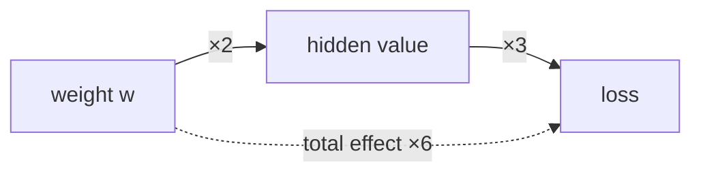

# Lesson 0.6 — Derivatives and gradient descent: how models learn

> [!summary] Tóm tắt (VI)
> Đạo hàm chỉ là độ dốc: đứng tại một điểm trên đường cong, đi sang phải một chút thì đi lên hay xuống, nhanh hay chậm.
> Hạ gradient là cách mọi mô hình học: đo độ dốc của hàm mất mát rồi bước ngược hướng dốc, lặp lại hàng nghìn lần. Tốc độ học quyết định bước dài hay ngắn.
> Không cần nhớ quy tắc đạo hàm. Bạn chỉ cần hiểu ý nghĩa, còn tính toán thì máy (PyTorch) làm hộ, ở bài sau.

**Time:** 2 hours · **You need:** NumPy, matplotlib · **Math:** ✏️ gentle (slope = rise ÷ run)

## Glossary

| English | Tiếng Việt | One-line meaning |
|---|---|---|
| slope | độ dốc | How much y changes when x moves a little |
| derivative | đạo hàm | The slope of a curve at one point |
| partial derivative | đạo hàm riêng | The slope when only one variable moves |
| gradient | gradient | The list of all partial derivatives; points uphill |
| loss function | hàm mất mát | A number measuring how wrong the model is |
| gradient descent | hạ gradient | Step against the gradient, again and again |
| learning rate | tốc độ học | How big each step is |
| converge / diverge | hội tụ / phân kỳ | Settle at the bottom / fly off to infinity |
| mean squared error (MSE) | sai số bình phương trung bình | Average of (prediction − truth)² |
| chain rule | quy tắc dây chuyền | Slopes along a chain multiply |
| backpropagation | lan truyền ngược | Using the chain rule to get every weight's slope |

## Warm-up (5 min, no peeking)

1. Softmax of `[0, 0]`?
2. The model gives the correct token probability 0.9. Is the loss big or small?
3. What happens to softmax probabilities when temperature goes up?

---

## Part 1 — A derivative is a slope (Pomodoro 1)

### Everyday picture

You are on a hill in fog, blindfolded. You cannot see the bottom, but you can **feel the slope under your feet**: is the ground going down to the left or to the right, and how steep? That local feeling is the derivative. To get down, step toward "down". That is the whole idea of training.

### Slope of a straight line

Slope = rise ÷ run. A road that climbs 2 m for every 10 m forward has slope 0.2. For `y = 3x + 1`, the slope is 3 everywhere.

### Slope of a curve

For a curve like `f(x) = x²`, the slope changes from point to point. The **derivative** is the slope at one exact point — the slope of the line that just touches the curve there.


### Computing it without any rules: nudge and measure

Move x by a tiny amount h and see how much f changes:

$$
\text{slope at } x \approx \frac{f(x + h) - f(x)}{h}
$$

For `f(x) = x²` at x = 3, with h = 0.001:

```
f(3.001) = 9.006001
f(3)     = 9
slope ≈ (9.006001 − 9) / 0.001 = 6.001   ≈ 6
```

Try x = −2: you get ≈ −4. Try x = 0: ≈ 0. The pattern is **slope = 2x**. That is the rule "the derivative of x² is 2x" — you just discovered it by measuring.

```python
def f(x):
    return x ** 2

def numerical_slope(f, x, h=1e-5):
    return (f(x + h) - f(x)) / h

for x in [-2, 0, 1.5, 3]:
    print(x, round(numerical_slope(f, x), 4))
```

Only three rules appear in this course; you do not need to memorise them:

| Function | Derivative | Why it makes sense |
|---|---|---|
| a constant, e.g. 5 | 0 | flat line, no slope |
| a·x | a | a straight line with slope a |
| x² | 2x | steeper the further from 0 |

**Sign tells the direction, size tells the steepness.** Positive slope → going right goes up. Negative → going right goes down.

---

## Part 2 — Gradient descent: walking downhill (Pomodoro 2)

The loss is a hill. The weights are your position. We want the lowest point. The recipe:

$$
w_{\text{new}} = w - \text{learning rate} \times \text{slope}
$$

Why the minus? If the slope is positive, going right goes up, so step left (subtract). If negative, step right. The minus sign always points downhill.

### By hand

Loss = w², slope = 2w. Start at w = 4, learning rate 0.25:

| Step | w | slope = 2w | step = 0.25 × slope | new w |
|---|---|---|---|---|
| 1 | 4 | 8 | 2 | 2 |
| 2 | 2 | 4 | 1 | 1 |
| 3 | 1 | 2 | 0.5 | 0.5 |
| 4 | 0.5 | 1 | 0.25 | 0.25 |

w heads to 0, the bottom. Notice the steps shrink on their own as the slope flattens near the bottom.

### The learning rate decides everything


- **Too small:** safe but painfully slow.
- **Just right:** reaches the bottom in a few steps.
- **Too big:** overshoots, bounces higher and higher — the loss explodes (diverges). When your training loss becomes `nan` or shoots up, suspect the learning rate first.

```python
w, lr = 4.0, 0.25
for step in range(10):
    slope = 2 * w
    w = w - lr * slope
    print(step, round(w, 5), "loss", round(w ** 2, 6))
```

Change `lr` to 0.01, 0.9 and 1.1 and watch.

---

## Part 3 — Many weights at once: fitting a line (Pomodoro 3)

### More than one weight → the gradient

A real model has many weights. For each one we ask "if I nudge *only this* weight, how does the loss change?" — that is a **partial derivative**. The list of all of them is the **gradient**. Gradient descent updates every weight with its own slope, all at the same time.

### A real (tiny) learning problem

Predict house price (billion VND) from area. The model: `price = w × area + b`. Two weights: w and b.

How wrong are we? **Mean squared error**: for every house, (prediction − truth)², then average. Squaring makes all errors positive and punishes big errors more.

The slopes (you can trust these, or check them with the nudge method in the exercises):

```
slope for w = 2 × average( (prediction − truth) × area )
slope for b = 2 × average(  prediction − truth )
```

Intuition: if predictions are too high on average, `prediction − truth` is positive, so the slope for b is positive and b goes down. Exactly what you would do by hand.

```python
import numpy as np

rng = np.random.default_rng(0)
area = rng.uniform(0.2, 1.0, 40)                        # in hundreds of m² (20–100 m²)
price = 5.0 * area + 0.5 + rng.normal(0, 0.35, 40)     # true rule + noise

w, b, lr = 0.0, 0.0, 0.5
for step in range(501):
    pred = w * area + b
    error = pred - price
    loss = np.mean(error ** 2)
    grad_w = 2 * np.mean(error * area)
    grad_b = 2 * np.mean(error)
    w -= lr * grad_w
    b -= lr * grad_b
    if step % 100 == 0:
        print(f"step {step:3d}  loss {loss:.4f}  w {w:.3f}  b {b:.3f}")
```

w should approach about 5 and b about 0.5 — the rule we hid in the data. The model **found it from examples**. That is learning.


Why is area in *hundreds* of m²? If inputs are large numbers (20–100), the slopes are large too and the same learning rate overshoots. Keeping inputs around 0–1 is a habit called **scaling** or **normalisation**; deep learning uses it everywhere.

### The chain rule in one picture

In a deep network, a weight affects the loss through many layers. Think of gears: if gear A turns gear B 2 times, and B turns C 3 times, then A turns C 2 × 3 = 6 times. Slopes along a chain **multiply**.



**Backpropagation** applies this rule from the loss backwards through every layer to get the slope of every weight. You will never do it by hand — PyTorch does it with one line, `loss.backward()`, in the next lesson.

---

## Exercises (Pomodoro 4)

### A. By hand

1. A straight road rises 15 m over 300 m. Slope?
2. For f(x) = x², what is the slope at x = 5? At x = −5? What do the signs tell you?
3. Loss = w², learning rate 0.1, start w = 10. Write w for 3 steps.
4. Same loss, learning rate 1.0, start w = 10. What happens? And with 1.5?
5. In the house-price model, all predictions are too low. Is the slope for b positive or negative? Does b go up or down?

### B. Code

6. Use `numerical_slope` to check the derivative of `g(x) = 3x² + 2x + 1` at x = 1. Guess the rule from 3 different x values.
7. In the house-price code, replace `grad_w` and `grad_b` with numerical slopes (nudge w, then nudge b, re-compute the loss). Do you get the same final w and b?
8. Run the house-price code with learning rates 0.05, 0.5, and 2.0. Plot the loss over steps for each (three lines on one chart). Describe what you see.

### C. Challenge (optional)

9. Use the original unscaled areas (20–100 m²) with `lr = 0.5`. What happens? Find a learning rate that works. Why is it so much smaller?

➡️ Answers: [[solution-0.6]]

## Feynman box

In 5 lines: what a derivative is (use the foggy hill), what gradient descent does, and what goes wrong with a bad learning rate.

## Key takeaways

- Derivative = slope at a point. You can always measure it by nudging.
- Gradient descent: `w ← w − lr × slope`, repeated. The minus sign points downhill.
- Learning rate too small = slow, too big = explodes. Scale inputs to keep slopes sane.
- Backpropagation = chain rule (slopes multiply), done automatically by PyTorch.

**Next:** [[lesson-0.7-pytorch-basics]]
