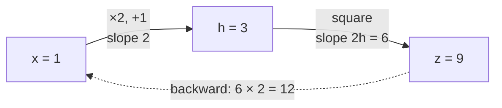
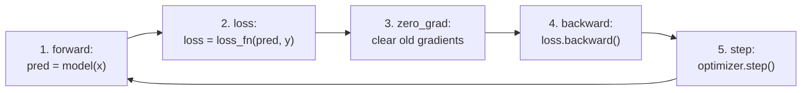

# Lesson 0.7 — PyTorch basics: tensors, autograd, the training loop

> [!summary] Tóm tắt (VI)
> PyTorch là "NumPy chạy được trên GPU và tự tính đạo hàm". Ba thứ cần nắm: tensor (mảng số), autograd (gọi `.backward()` là có gradient), và vòng lặp huấn luyện 5 bước.
> Vòng lặp 5 bước này xuất hiện trong mọi code huấn luyện, từ hồi quy tuyến tính đến LLM 70 tỷ tham số.
> Cuối bài có phép tính nhẩm bộ nhớ GPU: biết card 6GB chạy được mô hình cỡ nào.

**Time:** 2 hours · **You need:** PyTorch (Colab has it; laptop: see Part 1) · **Math:** none new

## Glossary

| English | Tiếng Việt | One-line meaning |
|---|---|---|
| tensor | tensor | PyTorch's array; like NumPy but can live on the GPU |
| dtype | kiểu số | float32, float16, int64… how each number is stored |
| device | thiết bị | `cpu` or `cuda` (GPU) |
| autograd | tự động tính đạo hàm | PyTorch records operations and computes gradients for you |
| `requires_grad` | cần gradient | Flag telling PyTorch "track this tensor" |
| `nn.Module` | mô-đun mạng | Base class for any model or layer |
| optimizer | bộ tối ưu | Applies `w ← w − lr × grad` (or a smarter version) |
| forward / backward pass | lượt truyền xuôi / ngược | Compute output and loss / compute gradients |
| VRAM | bộ nhớ GPU | Memory on the graphics card; the main limit for LLMs |

## Warm-up (5 min, no peeking)

1. Write the gradient descent update rule.
2. What happens when the learning rate is too big?
3. In one sentence, what does backpropagation do?

---

## Part 1 — Tensors and the GPU (Pomodoro 1)

### Install on your laptop

Go to pytorch.org → "Get Started", choose your OS, `pip`, Python, and the newest CUDA version listed. Copy the command it gives you into your `llm` environment. Then check:

```python
import torch
print(torch.__version__)
print("GPU available:", torch.cuda.is_available())
if torch.cuda.is_available():
    print(torch.cuda.get_device_name(0))                       # NVIDIA GeForce RTX 3050 ...
    print(round(torch.cuda.get_device_properties(0).total_memory / 1e9, 1), "GB")
```

If `GPU available: False` on the laptop: update the NVIDIA driver, and make sure you installed the CUDA build (not the CPU-only one). On Colab: Runtime → Change runtime type → T4 GPU.

### Tensors feel like NumPy

```python
import torch

a = torch.tensor([[1.0, 2.0], [3.0, 4.0]])
b = torch.ones(2, 2)
print(a.shape, a.dtype)        # torch.Size([2, 2]) torch.float32
print(a + b)
print(a @ b)                   # matrix multiplication, same as NumPy
print(a.mean(), a.max())
print(a.numpy())               # convert to NumPy (CPU tensors only)
```

### Moving to the GPU

```python
device = "cuda" if torch.cuda.is_available() else "cpu"
x = torch.randn(1000, 1000, device=device)
y = x @ x                      # runs on the GPU if available
print(y.device)
```

Rule: **all tensors in one operation must be on the same device**. The most common beginner error is `Expected all tensors to be on the same device`. Fix: `.to(device)` everywhere.

---

## Part 2 — Autograd: gradients for free (Pomodoro 2)

Remember Lesson 0.6: the slope of x² at x = 3 is 6. PyTorch gets it in one line:

```python
import torch

x = torch.tensor(3.0, requires_grad=True)   # "track operations on x"
y = x ** 2
y.backward()                                # backpropagation
print(x.grad)                               # tensor(6.)
```

A chain (gears from Lesson 0.6):

```python
x = torch.tensor(1.0, requires_grad=True)
h = 2 * x + 1          # h = 3, dh/dx = 2
z = h ** 2             # z = 9, dz/dh = 2h = 6
z.backward()
print(x.grad)          # 2 × 6 = 12
```

PyTorch built a little graph of operations while you computed, then walked it backwards multiplying slopes.



Two gotchas:
- Gradients **add up** each time you call `.backward()`. Reset them with `x.grad.zero_()` or `optimizer.zero_grad()`.
- To use values without tracking (e.g. when evaluating), wrap code in `with torch.no_grad():`.

---

## Part 3 — The training loop (Pomodoro 3)

Every training script in the world, from this toy to GPT-scale, repeats these 5 steps:



The house-price problem from Lesson 0.6, in PyTorch, on the GPU:

```python
import torch
from torch import nn

torch.manual_seed(0)
device = "cuda" if torch.cuda.is_available() else "cpu"

area = torch.rand(40, 1) * 0.8 + 0.2                       # (40, 1)
price = 5.0 * area + 0.5 + 0.35 * torch.randn(40, 1)       # (40, 1)
area, price = area.to(device), price.to(device)

model = nn.Linear(1, 1).to(device)          # y = w x + b, with w and b inside
loss_fn = nn.MSELoss()
optimizer = torch.optim.SGD(model.parameters(), lr=0.5)

for step in range(501):
    pred = model(area)                      # 1. forward
    loss = loss_fn(pred, price)             # 2. loss
    optimizer.zero_grad()                   # 3. clear old gradients
    loss.backward()                         # 4. compute new gradients
    optimizer.step()                        # 5. update weights
    if step % 100 == 0:
        print(step, round(loss.item(), 4))

print("w =", model.weight.item(), " b =", model.bias.item())
```

Compare with Lesson 0.6: no gradient formulas anywhere. That is why we use PyTorch.

### A real (small) neural network

Two layers with a "bend" in between can learn curves, not just lines:

```python
import torch
from torch import nn

class TinyNet(nn.Module):
    def __init__(self):
        super().__init__()
        self.layers = nn.Sequential(
            nn.Linear(1, 32),   # (batch,1) -> (batch,32)
            nn.ReLU(),          # the "bend": keep positives, zero out negatives
            nn.Linear(32, 1),   # (batch,32) -> (batch,1)
        )

    def forward(self, x):
        return self.layers(x)

torch.manual_seed(0)
x = torch.linspace(-3, 3, 200).unsqueeze(1)    # (200, 1)
y = torch.sin(x)                                # a curve a line cannot fit

net = TinyNet()
opt = torch.optim.Adam(net.parameters(), lr=0.01)   # Adam: a smarter version of SGD
for step in range(2000):
    loss = nn.functional.mse_loss(net(x), y)
    opt.zero_grad()
    loss.backward()
    opt.step()
print("final loss:", round(loss.item(), 5))
```

`ReLU` is what makes it more than a stack of matrix multiplications (two matrix multiplications in a row are still just one matrix multiplication — a straight-line model). Phase 1 starts from here.

### How big a model fits on 6 GB?

Each weight takes:

| Format | Bytes per weight | 1B-weight model | 7B-weight model |
|---|---|---|---|
| float32 | 4 | 4 GB | 28 GB |
| float16 / bfloat16 | 2 | 2 GB | 14 GB |
| 8-bit | 1 | 1 GB | 7 GB |
| 4-bit | 0.5 | 0.5 GB | 3.5 GB |

Add roughly 20–50% extra for the text being processed. So on your RTX 3050 6GB: models up to ~3B in float16, up to ~7–8B in 4-bit (tight). Training needs 3–4× more memory than running, which is why fine-tuning in Phase 2 uses tricks (LoRA, 4-bit) or Colab.

---

## Exercises (Pomodoro 4)

### A. Check your understanding

1. Name the 5 steps of the training loop in order. What breaks if you forget step 3?
2. What does `requires_grad=True` do?
3. `x = torch.tensor(2.0, requires_grad=True); y = 3 * x ** 2; y.backward()`. What is `x.grad`? (Use the rules from Lesson 0.6.)
4. Your code says `Expected all tensors to be on the same device`. What happened, and how do you fix it?
5. How much memory do the weights of a 3B model need in float16? In 4-bit?

### B. Code

6. Verify exercise 3 in code.
7. In the house-price loop, comment out `optimizer.zero_grad()`. Run it. What happens to the loss, and why?
8. Change `TinyNet` to have 4 hidden units instead of 32, then 128. Compare final losses. Plot `net(x)` against `y` for each.

### C. Challenge (optional)

9. Remove `nn.ReLU()` from `TinyNet`. What final loss do you get, and why can it not fit the sine curve anymore?

➡️ Answers: [[solution-0.7]]

## Feynman box

In 5 lines: what PyTorch gives you that NumPy does not, and the 5-step training loop.

## Key takeaways

- Tensors = NumPy arrays that can live on the GPU. Keep everything on one device.
- `loss.backward()` fills `.grad` for every tracked weight. Clear gradients every step.
- The 5-step loop never changes. Memory per weight decides which models fit your GPU.

**Next:** [[lesson-0.8-talking-to-an-llm]]
