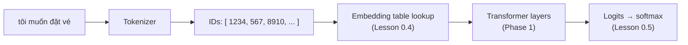

# Lesson 0.8 — Talking to an LLM: tokens, local models, APIs

> [!summary] Tóm tắt (VI)
> Lần đầu chạy một LLM thật trên máy mình. Ba việc: xem mô hình cắt câu tiếng Việt thành token ra sao (có dấu và không dấu khác nhau thế nào), chạy một mô hình nhỏ trên GPU và nhìn tận mắt xác suất cho chữ tiếp theo, rồi gọi mô hình qua API.
> Mọi thứ ở bài 0.3 đến 0.7 xuất hiện lại ở đây: token thành vectơ, nhân ma trận, softmax ra xác suất, nhiệt độ khi sinh văn bản.
> Phần đếm token là thí nghiệm nghiên cứu đầu tiên của bạn. Hãy ghi kết quả lại cẩn thận.

**Time:** 2 hours · **You need:** `pip install transformers accelerate` (+ `openai` for Part 3), GPU recommended · **Math:** none new

## Glossary

| English | Tiếng Việt | One-line meaning |
|---|---|---|
| token | token | A piece of text the model reads: a word, part of a word, or a byte |
| tokenizer | bộ tách token | Turns text into token IDs and back |
| vocabulary | bộ từ vựng | All tokens a model knows (often 100k–250k) |
| token ID | mã token | The integer for a token, used to look up its embedding row |
| context window | cửa sổ ngữ cảnh | Max tokens the model can read at once |
| chat template | mẫu hội thoại | How a list of messages is turned into one string for the model |
| instruct / chat model | mô hình đã tinh chỉnh theo chỉ dẫn | A base model further trained to follow instructions |
| `max_new_tokens` | số token sinh tối đa | Stop after this many new tokens |
| Hugging Face Hub | Hugging Face Hub | The main website for downloading open models and datasets |
| API / endpoint | API / điểm truy cập | A web address you send requests to |
| OpenAI-compatible API | API tương thích OpenAI | A common request format many providers and local servers accept |

## Warm-up (5 min, no peeking)

1. What are the 5 steps of the training loop?
2. How much memory do the weights of a 1B model need in float16?
3. What does temperature do to the next-token probabilities?

---

## Part 1 — Tokens: how the model sees your text (Pomodoro 1)



The first run downloads the tokenizer from the Hugging Face Hub (a few MB).

```python
from transformers import AutoTokenizer

model_id = "Qwen/Qwen2.5-0.5B-Instruct"     # small, multilingual, fits easily on 6 GB
tok = AutoTokenizer.from_pretrained(model_id)

sentences = {
    "vi":          "Tôi muốn đặt vé máy bay đi Đà Nẵng vào tối mai",
    "vi_no_marks": "Toi muon dat ve may bay di Da Nang vao toi mai",
    "en":          "I want to book a flight to Da Nang tomorrow evening",
}
for name, s in sentences.items():
    ids = tok.encode(s)
    pieces = [tok.decode([i]) for i in ids]
    print(f"{name:12} words={len(s.split()):2}  tokens={len(ids):2}")
    print("   ", pieces)
```

What to notice:
- Common English words are often one token each. Vietnamese syllables are sometimes one token, sometimes split into pieces.
- Some pieces print as `�`: the tokenizer works on **bytes** (Lesson 0.2), and a single Vietnamese letter can be split across two tokens. Decoding half a letter gives `�`.
- Token count = cost (APIs charge per token), speed, and how much fits in the context window.

**Fertility** = tokens ÷ words. A tokenizer with low fertility for a language "understands" its word shapes better.

> [!example] Research hook — your first measurement
> Fill this table for 2–3 different tokenizers (e.g. Qwen, Llama, Gemma — use any open models on the Hub you can download). Save it in your notes; it is pilot data for paper idea 1A.
>
> | Tokenizer | Fertility (vi) | Fertility (vi, no marks) | Fertility (en) |
> |---|---|---|---|
> | | | | |

---

## Part 2 — Run a model and look inside (Pomodoro 2)

### Generate text

```python
import torch
from transformers import AutoTokenizer, AutoModelForCausalLM

model_id = "Qwen/Qwen2.5-0.5B-Instruct"
device = "cuda" if torch.cuda.is_available() else "cpu"
tok = AutoTokenizer.from_pretrained(model_id)
model = AutoModelForCausalLM.from_pretrained(model_id, dtype="auto").to(device)

def chat(user_message, temperature=0.7, max_new_tokens=128):
    messages = [
        {"role": "system", "content": "Bạn là trợ lý hữu ích, trả lời ngắn gọn bằng tiếng Việt."},
        {"role": "user", "content": user_message},
    ]
    text = tok.apply_chat_template(messages, tokenize=False, add_generation_prompt=True)
    inputs = tok(text, return_tensors="pt").to(device)
    out = model.generate(
        **inputs,
        max_new_tokens=max_new_tokens,
        do_sample=temperature > 0,
        temperature=temperature if temperature > 0 else None,
    )
    new_tokens = out[0][inputs["input_ids"].shape[1]:]      # drop the prompt part
    return tok.decode(new_tokens, skip_special_tokens=True)

print(chat("Giải thích ngắn gọn mô hình ngôn ngữ lớn là gì."))
```

`apply_chat_template(..., tokenize=False)` shows you the actual string the model receives. Print `text` once — the special markers around each role are how a chat model knows who is speaking.

A 0.5B model is small: answers will be simple and sometimes wrong. That is fine for learning; bigger models use the same code.

### Look at the next-token probabilities

This is Lesson 0.5 happening inside a real model:

```python
import torch

prompt = "Sáng nay tôi ăn"
inputs = tok(prompt, return_tensors="pt").to(device)
with torch.no_grad():
    logits = model(**inputs).logits         # shape (1, number_of_tokens, vocab_size)
next_logits = logits[0, -1]                 # scores for the token AFTER the last one
probs = torch.softmax(next_logits.float(), dim=-1)
top = torch.topk(probs, 8)
for p, i in zip(top.values, top.indices):
    print(f"{tok.decode([int(i)])!r:12} {p.item():.3f}")
```

Note the shape: one row of logits per input position, each with one score per vocabulary token. We only need the last row.

---

## Part 3 — Calling models through an API (Pomodoro 3)

For bigger models you will call an API. Many providers, and local servers such as **Ollama** or **vLLM**, accept the same "OpenAI-compatible" format, so one piece of code works with all of them by changing `base_url` and `model`.

```python
import os
from openai import OpenAI

# Option 1 — a hosted provider: put your key in an environment variable, never in code.
# client = OpenAI(base_url="https://<provider>/v1", api_key=os.environ["LLM_API_KEY"])

# Option 2 — Ollama on your laptop (install from ollama.com, then: ollama pull qwen2.5:1.5b)
client = OpenAI(base_url="http://localhost:11434/v1", api_key="ollama")

response = client.chat.completions.create(
    model="qwen2.5:1.5b",
    messages=[
        {"role": "system", "content": "Trả lời ngắn gọn."},
        {"role": "user", "content": "Thủ đô của Việt Nam là gì?"},
    ],
    temperature=0.2,
)
print(response.choices[0].message.content)
print(response.usage)          # tokens used: what you pay for on hosted APIs
```

The `messages` list is the same dictionary shape you built in Lesson 0.2's `Conversation` class.

| | Local (transformers / Ollama) | Hosted API |
|---|---|---|
| Cost | free after hardware | pay per token |
| Model size | small (≤ 8B on your GPU) | any, including the largest |
| Privacy | data stays on your machine | data goes to the provider |
| Reproducibility | you control the exact version | providers may update models silently — record the date and model name in experiments |

For research, small open models are often the main subject of your experiments (all Q4/Q3 ideas use them), and big APIs serve as strong baselines or as judges.

---

## Exercises (Pomodoro 4)

### A. Check your understanding

1. Why can one Vietnamese letter be split across two tokens?
2. A text has 120 words and 210 tokens. What is the fertility?
3. In the logits tensor of shape (1, 9, 151936), what are 1, 9 and 151936?
4. Why record the date and model version when using a hosted API in experiments?

### B. Code

5. Write `fertility(tokenizer, text)` and compute it for the three sentences in Part 1. Add two more Vietnamese sentences of your own (one formal, one chatty).
6. Ask the model the same question 5 times at temperature 0 and 5 times at temperature 1.2. Compare the answers.
7. Show the top-5 next tokens for `"Thủ đô của Việt Nam là"` and for `"Thu do cua Viet Nam la"`. Does the probability of the right answer change?

### C. Challenge (optional)

8. Write `answer_logprob(prompt, answer)`: the total log-probability the model assigns to `answer` after `prompt` (add up log-probs of each answer token, one at a time). Compare `"Hà Nội"` vs `"Huế"` after `"Thủ đô của Việt Nam là "`, with and without diacritics in the prompt. This is a real evaluation technique used in benchmarks.

➡️ Answers: [[solution-0.8]]

## Feynman box

In 5 lines: what happens between typing a message and getting an answer — tokenizer, IDs, model, probabilities, decoding.

## Key takeaways

- Models read tokens (byte-based pieces), not words. Vietnamese and diacritic-free text tokenise differently.
- `logits[0, -1]` → softmax → next-token probabilities. Generation repeats this.
- One OpenAI-compatible client talks to local servers and hosted APIs alike. Record model versions.

**Next:** [[lesson-0.9-reading-research-papers]]
