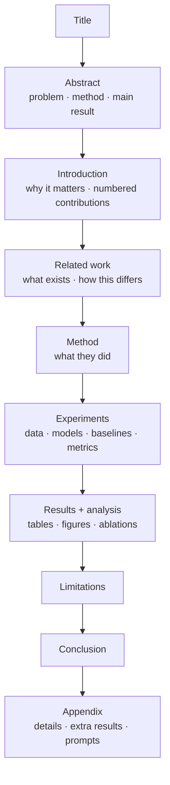
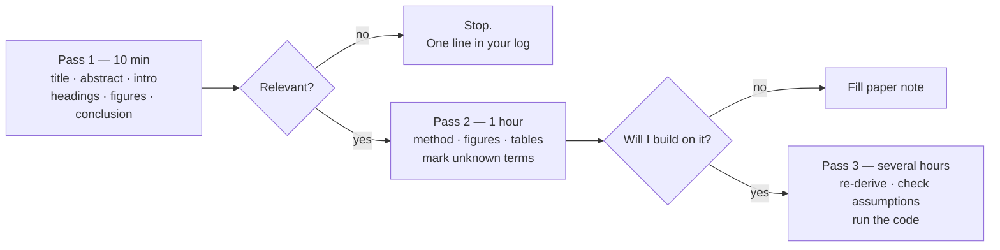
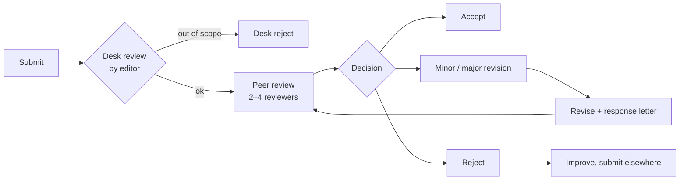

# Lesson 0.9 — Reading research papers without drowning

> [!summary] Tóm tắt (VI)
> Đọc bài báo không phải đọc từ đầu đến cuối. Dùng phương pháp ba lượt: lượt 1 (10 phút) chỉ đọc tiêu đề, tóm tắt, mở đầu, hình và kết luận để quyết định có đọc tiếp không; lượt 2 (1 tiếng) hiểu phương pháp và kết quả; lượt 3 chỉ dành cho bài bạn sẽ xây dựng tiếp.
> Bài này cũng giải thích Q1–Q4, Scopus, hội nghị và tạp chí trong ngành máy tính, cùng các dấu hiệu tạp chí "săn mồi" cần tránh.
> Từ hôm nay, mỗi tuần đọc ít nhất 2 bài ở lượt 1 và ghi vào mẫu ghi chú.

**Time:** 2 hours · **You need:** a PDF reader, the [[paper-note]] template · **Math:** none

## Glossary

| English | Tiếng Việt | One-line meaning |
|---|---|---|
| abstract | tóm tắt | The 150–250-word summary at the top |
| contribution | đóng góp | What is new in the paper, usually a numbered list in the introduction |
| related work | nghiên cứu liên quan | How the paper differs from earlier work |
| baseline | phương pháp đối chứng | What the new method is compared against |
| ablation | thí nghiệm loại bỏ | Remove one part to see if it matters |
| preprint | bản thảo trước phản biện | A paper posted before (or without) peer review, e.g. on arXiv |
| peer review | phản biện đồng cấp | Experts evaluate the paper before publication |
| venue | nơi công bố | The conference or journal |
| quartile (Q1–Q4) | phân hạng (Q1–Q4) | Where a journal ranks in its field: Q1 = top 25% |
| impact factor / SJR | chỉ số ảnh hưởng / SJR | Citation-based scores used to rank journals |
| predatory journal | tạp chí săn mồi | Charges authors, publishes almost anything, little real review |
| camera-ready | bản hoàn chỉnh | The final version after acceptance |

## Warm-up (5 min, no peeking)

1. What does `logits[0, -1]` select, and why?
2. Define fertility of a tokenizer.
3. Name one advantage of local models and one of hosted APIs.

---

## Part 1 — Anatomy of an ML/NLP paper (Pomodoro 1)



Where to look for what:

| You want to know… | Read |
|---|---|
| Is this paper relevant to me? | Abstract, last paragraph of the introduction |
| What exactly is new? | The numbered contributions in the introduction |
| What is the gap I could fill? | **Limitations** section, and what the experiments did *not* test |
| Does it really work? | Main results table: compare against baselines, look for ± and number of runs |
| How to reproduce it? | Experiments section + appendix + code link |

Five types of papers — knowing the type tells you what to expect:

| Type | Contribution | Example from your idea list |
|---|---|---|
| Method | A new technique that beats baselines | 1D, 2C, 3C, 4C |
| Resource | A new dataset or benchmark | 2B, part of 3A |
| Analysis | Explains *why* something happens | 1A, 1C, 4A |
| Empirical study | Careful comparison of existing options | 1B, 2A, 2D |
| Survey / position | Organises a field / argues for a view | (later in your career) |

---

## Part 2 — The three-pass method (Pomodoro 2)



**Pass 1 (10 minutes).** Read only: title, abstract, introduction, section headings, figure captions, conclusion. Then answer the five C's:
1. **Category:** which of the five types?
2. **Context:** which earlier papers does it build on?
3. **Correctness:** do the assumptions look reasonable?
4. **Contributions:** what is new, in one sentence?
5. **Clarity:** is it well written?

Most papers stop here. That is normal and efficient.

**Pass 2 (about 1 hour).** Look carefully at figures and tables. Read the method. Skip proofs. Circle terms you do not know, look up only the ones that block understanding. Fill [[paper-note]].

How to read a results table:
- Find the **baselines** and the **proposed method** rows.
- Bold = best per column. Is the improvement large, or 0.3 points?
- Look for **±** (standard deviation) or confidence intervals, and how many runs/seeds. A 0.3-point gain from a single run is weak evidence.
- Is the test set public? Large enough?

**Pass 3** only for the 3–5 papers your own paper extends. Try to re-implement or run their code; list every assumption; ask "what would break this?". Your research ideas come from here.

### Where to find papers

| Tool | Use it for |
|---|---|
| arXiv (cs.CL, cs.AI, cs.LG) | newest preprints; most ML papers appear here first |
| ACL Anthology | all NLP conference papers (ACL, EMNLP, NAACL, Findings, workshops) |
| Semantic Scholar | search, citation counts, "highly influential citations" |
| Google Scholar | search + alerts for keywords and authors |
| Connected Papers | graph of papers similar to one seed paper |
| Hugging Face Papers | daily popular papers, often with code and models |
| Zotero (free) | store PDFs, export references for your own paper |

---

## Part 3 — How publishing works in computer science (Pomodoro 3)

### Conferences vs journals

In most sciences, journals are the main venue. In AI/NLP, **top conferences** (ACL, EMNLP, NAACL, NeurIPS, ICLR, ICML) are the most prestigious, and *Findings* papers of ACL conferences are well respected. Conferences have fixed deadlines and faster decisions (2–4 months). Journals take longer (3–12 months) but allow longer papers and revisions.

### What Q1–Q4 means

Databases like **Scopus** list journals that pass basic quality checks. **SCImago (SJR)** ranks every journal within a subject category by citation influence, then splits the list into four quarters:

```
Q1 = top 25%   Q2 = 25–50%   Q3 = 50–75%   Q4 = bottom 25%
```

A journal can be Q1 in one category and Q2 in another, and quartiles change every year. Many universities and grant agencies in Vietnam count Scopus/WoS-indexed papers and their quartile, so always check the journal on scimagojr.com for the **current** year before submitting. Conference proceedings in Scopus often have no quartile.

### The review process



Rejection is normal — even strong researchers get rejected often. Reviews are free expert feedback; use them.

### Red flags: predatory journals

- They email you asking for submissions, praising your "excellent work".
- Promise review in days, acceptance almost guaranteed.
- Very broad scope ("all fields of science and engineering").
- High fee, little information about the editorial board, or editors not from the field.
- Not in Scopus, or on Scopus' list of discontinued titles.

Publishing there can hurt your record. When unsure, ask a senior researcher.

---

## Exercises (Pomodoro 4)

### A. Pass 1 practice (10 minutes each, use the timer strictly)

Do pass 1 on these three papers and fill the "Pass 1" part of [[paper-note]] for each:

1. *Attention Is All You Need* (Vaswani et al., 2017) — arXiv 1706.03762. The paper behind every LLM.
2. *How Robust Are LLMs to Vietnamese Dialects?* (2026) — arXiv 2608.10414.
3. *Which Works Best for Vietnamese? A Practical Study of Information Retrieval Methods across Domains* — EACL 2026 Findings (search it on the ACL Anthology).

### B. Questions

4. For paper 2, what does it **not** test, according to its limitations? How does that relate to your paper ideas?
5. A journal is Q2 in "Computer Science Applications" and Q3 in "Artificial Intelligence". Which quartile can you claim?
6. You receive an email: "Dear Esteemed Researcher, submit to our journal, review in 7 days, APC 300 USD". What do you check before replying?

### C. Challenge (optional)

7. Open the paper-ideas folder ([[06 - Courses/llm-agent-research-course/paper-ideas/README]]). Pick the idea that excites you most. Find 3 papers related to it using Semantic Scholar or Connected Papers and do pass 1 on each.

➡️ Answers: [[solution-0.9]]

## Feynman box

In 5 lines: the three passes, and how you would decide whether a journal is safe to submit to.

## Key takeaways

- Read in passes; most papers only deserve pass 1. Gaps hide in limitations and in what was *not* tested.
- In AI/NLP, top conferences rival or beat journals. Quartiles are per category and per year — always check.
- Avoid predatory venues; check Scopus and SJR yourself.

**Next:** [[lesson-0.10-mini-project-semantic-search]]
