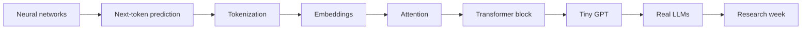

# Phase 1 — Transformers: tokens, embeddings, attention (outline)

> [!summary] Tóm tắt (VI)
> Bốn tuần, 12 bài. Đi từ mạng nơ-ron đơn giản, qua mô hình đoán chữ tiếp theo, tách token, embedding, cơ chế chú ý, đến tự tay huấn luyện một "GPT tí hon" bằng văn bản tiếng Việt trên laptop.
> Đây là bản đề cương. Nội dung chi tiết, bài tập và thẻ Anki sẽ được viết khi bạn học xong Phase 0.
> Tuần cuối là "tuần nghiên cứu": làm thí nghiệm nhỏ về tokenizer và chốt ý tưởng bài báo đầu tiên.

**Calendar:** 4 weeks, learning mode · **Compute:** RTX 3050 is enough · **Builds on:** all of Phase 0

## Goals

By the end you can:
- explain attention with a drawing and compute it by hand for 3 tokens;
- write a small GPT in ~150 lines of PyTorch and train it on Vietnamese text;
- train a BPE tokenizer and measure fertility on clean and diacritic-free Vietnamese;
- read a model card and know what "7B, 32k context, bf16, instruct" means.

## Lessons

| # | Lesson | Math | Uses from Phase 0 |
|---|---|---|---|
| 1.1 | From neurons to networks: layers, activations, forward pass | ✏️ | matrices, ReLU |
| 1.2 | Training on real data: batches, epochs, train/validation split, overfitting | | training loop |
| 1.3 | Language modelling = next-token prediction: a bigram model, first by counting, then as a network | ✏️ | softmax, cross-entropy |
| 1.4 | Tokenization: characters vs words vs BPE (by hand), training a tokenizer, fertility | | Unicode, bytes |
| 1.5 | Embeddings: learned lookup tables, word2vec intuition, sentence embeddings | ✏️ | vectors, cosine |
| 1.6 | Attention I: intuition — each token looks up the tokens it needs (query, key, value) | | dot product |
| 1.7 | Attention II: scaled dot-product, causal mask, multi-head — by hand on 3 tokens | ✏️ | matrices, softmax |
| 1.8 | The Transformer block: residual connections, layer normalisation, MLP, positional information | ✏️ | scaling inputs |
| 1.9 | Build a tiny GPT in PyTorch | | PyTorch |
| 1.10 | Train it on Vietnamese text, sample from it, measure perplexity | | perplexity |
| 1.11 | From tiny GPT to real LLMs: scaling, pretraining data, instruction tuning, model cards | | memory estimates |
| 1.12 | **Research week:** tokenizer pilot study (for idea 1A) + choose Paper 1 idea + novelty check | | reading papers |

## How it flows

## Paper ideas attached to this phase

[[phase-1-ideas]]: 1A (tokenizer-level analysis, Q4/Q3), 1B (compact embeddings, Q4), 1C (mechanistic study of diacritic restoration, Q2/Q1), 1D (diacritic-robust embeddings, Q2/Q1).

## Exit check

- [ ] I can compute attention weights for 3 tokens by hand.
- [ ] My tiny GPT trains and its validation loss goes down.
- [ ] I can explain why BPE splits rare words into pieces.
- [ ] I have chosen my Paper 1 idea and filled its "closest 5 papers" table.
